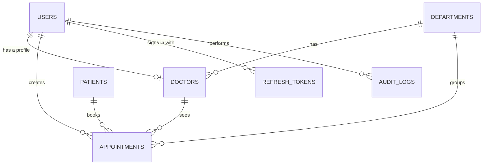

# EMR Appointment Management

Appointment management module for an enterprise EMR system. It covers role-based access (Super Admin, Receptionist, Doctor), doctor schedules, dynamically generated slots, booking that is safe against double booking, and real-time scheduler updates.

> **Status:** the backend (`server/`) is being built phase by phase. Design decisions are recorded in [`docs/decisions-notes.md`](docs/decisions-notes.md). The frontend hasn't been started.

## Tech stack

- **Server:** Node.js (>= 20.19), Express 5, MongoDB with Mongoose, zod, JWT, bcrypt, Socket.IO, TypeScript (strict)
- **Tooling:** tsx (development), tsc (build), ESLint and Prettier, Vitest with supertest and mongodb-memory-server

## Getting started (server)

```bash
cd server
npm install
cp .env.example .env   # then fill in real values
npm run dev
```

## Scripts (server)

| Command | What it does |
| --- | --- |
| `npm run dev` | Starts the API with auto-reload (tsx) |
| `npm run build` | Compiles TypeScript to `dist/` (tsc) |
| `npm start` | Runs the compiled build |
| `npm run seed` | Creates the first Super Admin and the departments from env vars |
| `npm run lint` | ESLint (type-aware) |
| `npm run format` | Prettier |
| `npm run typecheck` | `tsc --noEmit` |
| `npm test` | Vitest unit and integration tests (in-memory MongoDB replica set, never Atlas) |

## Environment variables (server)

Copy `server/.env.example` to `server/.env`. Never commit `.env`.

The server validates these at startup and refuses to start if any are invalid, naming the variable but never printing its value.

| Variable | Description | Default |
| --- | --- | --- |
| `NODE_ENV` | `development`, `test` or `production` | `development` |
| `PORT` | HTTP port | `5000` |
| `LOG_LEVEL` | `fatal`, `error`, `warn`, `info`, `debug`, `trace` or `silent` | `info` |
| `MONGO_URI` | MongoDB (Atlas) connection string | required |
| `MONGO_SERVER_SELECTION_TIMEOUT_MS` | How long to wait for MongoDB at startup | `10000` |
| `CLIENT_URL` | Frontend origin allowed by CORS (with credentials) | `http://localhost:5173` |
| `CLINIC_TIMEZONE` | IANA timezone for all appointment dates and times | `Asia/Kolkata` |
| `TRUST_PROXY_HOPS` | Reverse proxies in front of the API, so client IPs and rate limits are correct | `0` |
| `BODY_LIMIT` | Maximum JSON body size | `100kb` |
| `RATE_LIMIT_WINDOW_MS` | Rate limit window | `900000` (15 minutes) |
| `RATE_LIMIT_MAX` | Requests per client IP per window, across the API | `300` |
| `LOGIN_RATE_LIMIT_MAX` | Failed logins per client IP per window | `10` |

## API conventions

Base path: `/api/v1`. Every response, success or error, uses the same envelope:

```json
{
  "success": true,
  "message": "Service is healthy",
  "data": { "status": "ok", "database": "up" },
  "meta": {}
}
```

Errors have `success: false` and `data: null`. `meta.requestId` matches the `X-Request-Id` response header, and validation errors list each problem in `meta.errors` as `{ "field": "body.email", "message": "Invalid email address" }`.

| Status | When |
| --- | --- |
| 400 | Invalid input: failed validation, malformed JSON, or an invalid id |
| 401 | Missing, invalid or expired token |
| 403 | Authenticated, but the role is not allowed |
| 404 | Unknown route or resource |
| 409 | Conflict, for example a slot that is already booked |
| 413 | Request body larger than `BODY_LIMIT` |
| 422 | Valid input that breaks a business rule, for example a slot in the past |
| 429 | Rate limit exceeded |
| 500 | Unexpected error. Details are logged with the request id and never returned. |
| 503 | Health check only: the database is unavailable |

### Endpoints

| Method | Path | Auth | Description |
| --- | --- | --- | --- |
| `GET` | `/api/v1/health` | none | Service and database status: 200, or 503 when the database is down |

## Database design

MongoDB with Mongoose. How the collections relate:



| Collection | What it stores |
| --- | --- |
| `users` | Staff accounts: name, email (unique), role, active flag, and the bcrypt password hash, which is never returned |
| `departments` | Department names (unique, case-insensitive) |
| `doctors` | Doctor profiles: user, department, name, specialization, slot length, and the weekly schedule of working days with sessions and breaks |
| `patients` | Patient code (`PAT-000001`), name, mobile, gender and date of birth |
| `appointments` | Patient, doctor, department, date, slot, purpose, notes, status with a timestamp per status change, plus copies of the patient's and doctor's names for search |
| `audit_logs` | Who did what to which record, and when (append-only) |
| `refresh_tokens` | Hashed refresh tokens with expiry, revocation and rotation |
| `counters` | Atomic sequences, used for patient codes |

A sample appointment:

```json
{
  "_id": "6711a2f4c1d2e3f4a5b6c7d8",
  "patientId": "6711a2f4c1d2e3f4a5b6c7a1",
  "doctorId": "6711a2f4c1d2e3f4a5b6c7b2",
  "departmentId": "6711a2f4c1d2e3f4a5b6c7c3",
  "date": "2026-10-20",
  "slotStart": "09:15",
  "slotEnd": "09:30",
  "purpose": "Follow-up",
  "notes": "",
  "status": "SCHEDULED",
  "createdBy": "6711a2f4c1d2e3f4a5b6c7e4",
  "patientCode": "PAT-000042",
  "patientName": "Asha Rao",
  "patientNameLower": "asha rao",
  "patientMobile": "9876543210",
  "doctorName": "Dr. Kavya Mehta",
  "createdAt": "2026-10-17T10:02:11.000Z",
  "updatedAt": "2026-10-17T10:02:11.000Z"
}
```

Double booking is prevented by a unique index on `{ doctorId, date, slotStart }` that covers only active appointments, so a cancelled slot can be booked again. Every index, and the reason for it, is listed in [`docs/decisions-notes.md`](docs/decisions-notes.md).

## Project structure

```text
server/
  src/      application code: config, constants, controllers, middlewares, models,
            routes, services, sockets, scripts, types, validators, utils
  tests/    unit/, integration/, helpers/
docs/       assessment brief and design decision notes
```

Server modules import each other through the `#app/*` alias (for example `#app/config/env.js`), which Node resolves natively through `package.json` `imports`.
