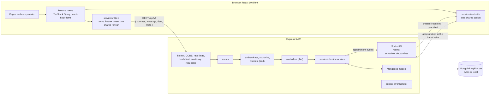
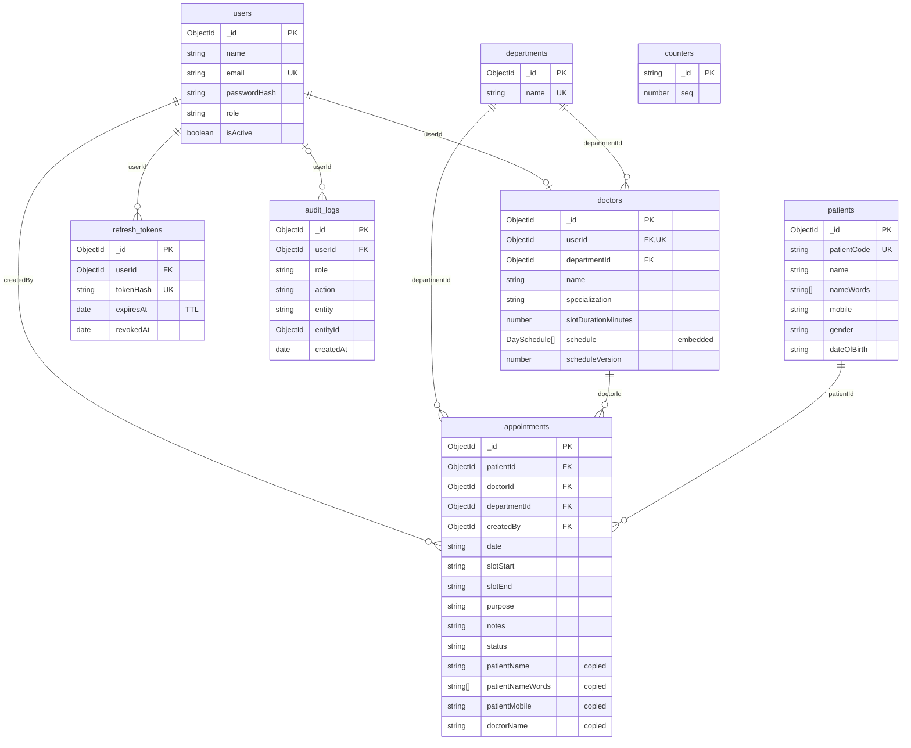

# EMR Appointment Management

The appointment module of an enterprise EMR system: role-based access (Super Admin, Receptionist, Doctor), doctor schedules, slots generated on the fly, booking that can't double-book, and a scheduler that updates live. It is a MERN application in TypeScript: an Express 5 API on MongoDB, and a React 19 client.

## Contents

- [Project overview](#project-overview)
- [Folder structure](#folder-structure)
- [Architecture overview](#architecture-overview)
- [Database design](#database-design)
- [API documentation](#api-documentation)
- [Environment variables](#environment-variables)
- [Installation](#installation)
- [Running the project](#running-the-project)
- [Testing](#testing)
- [Assumptions made](#assumptions-made)
- [Known limitations](#known-limitations)
- [Future improvements](#future-improvements)

Design reasoning: [`ENGINEERING_DECISIONS.md`](ENGINEERING_DECISIONS.md), with the phase-by-phase notes in [`docs/decisions-notes.md`](docs/decisions-notes.md).

## Project overview

| Screen | Who | What it does |
| --- | --- | --- |
| Login | everyone | Email and password. A reload keeps you signed in, through a silent refresh with the httpOnly cookie. |
| Dashboard | everyone | Today by status, who is waiting and who is next. A doctor sees only their own day; a Super Admin also sees each doctor's load. |
| Scheduler | everyone | One doctor's day as a sheet of slots, laid out by session, with breaks shown. Free slots link to booking, booked ones open the appointment, and past ones are hatched. It updates live over Socket.IO. |
| Book appointment | Super Admin, Receptionist | Choose a doctor, day and free slot, then find the patient by ID, mobile or any word of the name, or register a new one ("Is it one of these?" warns about a registered mobile). A slot someone else just took is caught (409) and the slots refresh. |
| Appointments | everyone | Server-side paging, sorting and filters (patient, mobile, doctor, department, status, dates), kept in the URL. Row actions depend on the role: check in, complete, edit, cancel. |
| Staff and schedules | Super Admin | Add doctors and receptionists, and edit each doctor's days, sessions, breaks and slot length. A change that would strand a booking, or that someone else saved over first, is refused with an explanation. |

**Status.** Complete and tested:
- **Server:** 226 tests, about 93% of lines covered.
- **Client:** 117 unit and component tests, and 92 Playwright end-to-end tests against the real API.
- **Manual QA:** an end-to-end pass, run like real clinic use against a real MongoDB, is written up in [`docs/MANUAL_TEST_REPORT.md`](docs/MANUAL_TEST_REPORT.md). It found 12 bugs, all fixed, and nine questions: five resolved by changes and four kept and documented below.

**Tech stack.**
- **Server:** Node.js (>= 20.19), Express 5, MongoDB with Mongoose 9, zod 4, JWT, bcrypt, Socket.IO 4, pino, luxon.
- **Client:** React 19 with Vite 8, React Router 7, TanStack Query 5, axios, react-hook-form with zod, socket.io-client, Tailwind CSS 4.
- **Tooling:** TypeScript (strict) and ESLint (type-aware) with Prettier everywhere; Vitest with supertest and mongodb-memory-server on the server; Vitest with Testing Library, and Playwright with axe-core, on the client.

## Folder structure

```text
server/
  src/
    config/        env (validated with zod), database, logger
    constants/     roles, statuses, audit actions, events, conflict codes
    routes/        one router per resource, under /api/v1
    validators/    zod schemas for body, query and params
    controllers/   thin: read the validated input, call a service, send the envelope
    services/      all business rules: auth, doctors, slots, appointments, patients, audit
    models/        Mongoose schemas and indexes
    middlewares/   authenticate, authorize, validate, rate limits, origin check,
                   input sanitizing, request id and logging, errors
    sockets/       Socket.IO server, rooms and the appointment broadcaster
    scripts/       seed, secrets, indexes:sync, backfill:name-words
    utils/ types/
  tests/           unit/, integration/ (through the HTTP API), helpers/
client/
  src/
    app/           providers, router, layout shell
    components/    shared UI (ui/), layout/, feedback/ (toasts, error boundary)
    features/      auth, dashboard, scheduler, booking, appointments, admin,
                   doctors, departments, patients, slots: each owns its API calls
                   (api.ts), query keys, hooks, components, pages, zod schemas and utils
    services/      the HTTP clients, the socket, the query client
    hooks/ utils/ types/ constants/ config/ styles/ test/
  e2e/             Playwright specs; support/ holds the test stack, seed data and helpers
docs/              API.md, DATABASE_DESIGN.md (+ database-design.html), decisions-notes.md,
                   MANUAL_TEST_REPORT.md, postman_collection.json
ENGINEERING_DECISIONS.md
```

Server modules import each other through the `#app/*` alias (for example `#app/config/env.js`), which Node resolves from `package.json` `imports`. Client modules use `@/` (for example `@/services/http`), which Vite and TypeScript resolve.

## Architecture overview



- **One request path:** route, then authentication, role check and zod validation, then a thin controller and a service. Services hold every rule and return plain typed objects. Errors are thrown as `AppError` and turned into the response envelope by one error handler; nothing unexpected leaks its message.
- **Auth:** a 15-minute access JWT kept in memory by the client, and a 7-day refresh JWT in an httpOnly cookie, rotated on every use, with reuse detection.
- **Double booking** is decided by a partial unique index, not by a check before inserting. Schedule changes that would strand a booking, and stale schedule saves, are refused.
- **Real time:** the appointment service publishes events after each saved change. Socket.IO sends them to the room of that doctor and day, and the client patches its cache.

The reasoning behind each of these is in [`ENGINEERING_DECISIONS.md`](ENGINEERING_DECISIONS.md).

## Database design

The full design is in [`docs/DATABASE_DESIGN.md`](docs/DATABASE_DESIGN.md):
- every collection's fields, with sample documents
- the relationships, with each index and the query it serves
- the booking, status and auth flows
- query plans measured with `explain`
- how the design would scale

The same content, with rendered diagrams, is in [`docs/database-design.html`](docs/database-design.html), which loads Mermaid from a CDN.



- **Embedded:** a doctor's weekly schedule.
- **Referenced:** appointments point to the patient, doctor, department and creator. They also copy the names and mobile that lists search and sort on, so lists need no `$lookup`.
- **Dates and times** are clinic-timezone strings (`"YYYY-MM-DD"`, `"HH:mm"`).
- **Slots** are computed from the schedule and never stored.
- **Double booking** is stopped by a unique index on `{ doctorId, date, slotStart }` that covers only active appointments, so a cancelled slot can be booked again.

## API documentation

- **Reference:** [`docs/API.md`](docs/API.md) covers every endpoint (roles, parameters, validation rules, a curl example, and real success and error responses), the permissions matrix, the status workflow, slot rules, concurrency, paging and filters, the Socket.IO events, every error code and the rate limits.
- **Postman:** [`docs/postman_collection.json`](docs/postman_collection.json) (v2.1) has every endpoint, with saved example responses:
  1. Import it, and set `adminEmail` and `adminPassword` to the Super Admin from `npm run seed`. `baseUrl` defaults to `http://localhost:5000/api/v1`.
  2. Run **Auth > Log in** first. It stores `accessToken`, which the other requests send.
  3. Run the folders top to bottom: each request stores the ids (and the doctor's `scheduleVersion`) that the next ones use.

  Postman sends no `Origin` header, which the API accepts. Only a browser on another site is refused on the cookie endpoints.

**Conventions.** The base path is `/api/v1`. Every response, success or error, is `{ success, message, data, meta }`.
- **Lists** take `page` (default 1) and `limit` (default 20, at most 100), and return `meta: { page, limit, total, totalPages }`.
- **Errors** have `data: null`. `meta.requestId` matches the `X-Request-Id` header, validation problems are listed in `meta.errors` as `{ field, message }`, and some 409s name their reason in `meta.code`.

| Status | When |
| --- | --- |
| 400 | Failed validation, malformed JSON or an invalid id |
| 401 | Missing, invalid or expired token |
| 403 | The role isn't allowed, or a foreign `Origin` on the cookie endpoints |
| 404 | Unknown route or resource, including another doctor's records |
| 409 | A conflict: the slot is taken; the status change isn't allowed; the email is used; a schedule change would strand bookings; the schedule was saved by someone else first; or a booking raced a schedule change |
| 413 | A body over `BODY_LIMIT` |
| 422 | Valid input that breaks a rule: a slot not offered, in the past, or an unknown department |
| 429 | Rate limit |
| 500 | Unexpected; logged with the request id, never explained in the response |
| 503 | Health check only: the database is down |

| Method | Path | Roles | What it does |
| --- | --- | --- | --- |
| `GET` | `/health` | public | Service and database status (503 when the database is down) |
| `POST` | `/auth/login` | public | Returns an access token and sets the refresh cookie |
| `POST` | `/auth/refresh` | refresh cookie | A new access token; rotates the cookie |
| `POST` | `/auth/logout` | refresh cookie | Revokes the refresh token and clears the cookie |
| `GET` | `/departments` | all | Departments, by name |
| `POST` | `/users/receptionists` | Super Admin | Creates a receptionist |
| `POST` | `/doctors` | Super Admin | Creates a doctor's account and profile together |
| `GET` | `/doctors` | all | Doctors by `departmentId` and `search`, paginated; a doctor sees only themselves |
| `GET` | `/doctors/:id` | all | One doctor, with the schedule and its `scheduleVersion` |
| `PUT` | `/doctors/:id/schedule` | Super Admin | Replaces the week (and optionally the slot length). Sends the `scheduleVersion` it was based on. |
| `GET` | `/slots?doctorId=&date=` | all | One day's slots: `AVAILABLE`, `BOOKED` (with the appointment id) or `PAST` |
| `GET` | `/patients?search=` | Super Admin, Receptionist | By patient code, the start of a mobile number, or words that each start a word of the name |
| `POST` | `/appointments` | Super Admin, Receptionist | Books a slot for `patientId`, or for a `newPatient` registered in the same transaction |
| `GET` | `/appointments` | all | Paged, sorted and filtered; a doctor sees only their own |
| `GET` | `/appointments/:id` | all | One appointment with the full patient |
| `PUT` | `/appointments/:id` | all | `purpose` and `notes`; a doctor, notes only |
| `DELETE` | `/appointments/:id` | Super Admin, Receptionist | Cancels (soft) and frees the slot |
| `POST` | `/appointments/:id/arrive` | Super Admin, Receptionist | SCHEDULED to ARRIVED |
| `POST` | `/appointments/:id/complete` | Super Admin, Doctor (own) | ARRIVED to COMPLETED |

**Real-time updates.** Socket.IO runs on the API's port:

```js
const socket = io('http://localhost:5000', { auth: { token: accessToken } });
socket.emit('scheduler:join', { doctorId, date: '2026-10-20' }, (result) => {}); // { ok, room } or { ok: false, error }
socket.on('appointment:created', (appointment) => {});
socket.on('appointment:updated', (appointment) => {});
socket.on('appointment:cancelled', (appointment) => {});
```

Rooms are `scheduler:{doctorId}:{date}`, and a screen sends `scheduler:leave` when it moves on. Doctors can join only their own; Super Admins receive everything. Events go out after the change is saved and never carry notes. The socket closes when the access token expires, and the client reconnects with a fresh one.

## Environment variables

**Server** (`server/.env`, copied from `server/.env.example`; never committed). Validated at startup. An invalid value stops the server and names the variable, never its value.

| Variable | Description | Default |
| --- | --- | --- |
| `MONGO_URI` | MongoDB connection string. Must be a replica set (Atlas, or a local `mongod --replSet`), because bookings with new patients use transactions. | required |
| `JWT_ACCESS_SECRET` | Signs access tokens; at least 32 characters. `npm run secrets` fills it in. | required |
| `JWT_REFRESH_SECRET` | Signs refresh tokens; at least 32 characters, different from the access secret | required |
| `NODE_ENV` | `development`, `test` or `production` | `development` |
| `PORT` | HTTP port | `5000` |
| `LOG_LEVEL` | `fatal` to `trace`, or `silent` | `info` |
| `MONGO_SERVER_SELECTION_TIMEOUT_MS` | How long to wait for MongoDB at startup | `10000` |
| `CLIENT_URL` | The frontend origin allowed by CORS and by the origin check on the cookie endpoints | `http://localhost:5173` |
| `CLINIC_TIMEZONE` | IANA timezone of every appointment date and time | `Asia/Kolkata` |
| `JWT_ACCESS_TTL_SECONDS` | Access token lifetime | `900` |
| `REFRESH_TOKEN_TTL_DAYS` | Refresh token lifetime | `7` |
| `REFRESH_COOKIE_SAMESITE` | `strict`, `lax` or `none` (`none` when the frontend and API are on different sites) | `strict` |
| `BCRYPT_ROUNDS` | bcrypt cost; at least 10 in production | `12` |
| `TRUST_PROXY_HOPS` | Reverse proxies in front of the API, so client IPs and rate limits are right | `0` |
| `BODY_LIMIT` | Maximum JSON body | `100kb` |
| `RATE_LIMIT_WINDOW_MS`, `RATE_LIMIT_MAX` | Requests per client IP per window, across the API | `900000`, `300` |
| `LOGIN_RATE_LIMIT_MAX` | Failed logins per client IP per window | `10` |
| `SEED_ADMIN_NAME`, `SEED_ADMIN_EMAIL`, `SEED_ADMIN_PASSWORD` | The first Super Admin, read only by `npm run seed`. The password needs 8 to 72 characters with a letter and a number. | `Super Admin`, `admin@example.com`, none |
| `SEED_DEPARTMENTS` | Comma-separated departments, read only by `npm run seed` | five common departments |

**Client** (`client/.env.local`, copied from `client/.env.example`). All three are optional and validated at startup. They are compiled into the bundle, so they are public: never put a secret in them.

| Variable | Description | Default |
| --- | --- | --- |
| `VITE_API_URL` | The REST API, including `/api/v1`. A path such as `/api/v1` works behind a reverse proxy on the app's origin. | `http://localhost:5000/api/v1` |
| `VITE_SOCKET_URL` | The Socket.IO server's origin | the origin of `VITE_API_URL` |
| `VITE_CLINIC_TIMEZONE` | Must match the server's `CLINIC_TIMEZONE`: it decides "today" and which slots are past | `Asia/Kolkata` |

## Installation

**You need:**
- **Node.js 20.19 or later**, with npm. Node 22 or 24 LTS is recommended, since Node 20 is end-of-life.
- **A MongoDB 6+ replica set.** Bookings that register a patient, and doctor creation, use transactions, which a standalone `mongod` refuses. Either:
  - **MongoDB Atlas:** any cluster is a replica set; use its connection string.
  - **Local:** start a single-node replica set and initiate it once. `mongod` needs its data folder to exist, and `mongosh` is the MongoDB Shell, a separate download from the server. `mongo-data/` is gitignored, so the folder can sit in the repository's root:

    ```bash
    mkdir mongo-data
    mongod --replSet rs0 --port 27017 --dbpath ./mongo-data
    # in another terminal, once:
    mongosh --eval "rs.initiate({ _id: 'rs0', members: [{ _id: 0, host: '127.0.0.1:27017' }] })"
    # then, in server/.env:
    # MONGO_URI=mongodb://127.0.0.1:27017/emr_appointments?replicaSet=rs0
    ```
- **Free ports** 5000 (API) and 5173 (app). The end-to-end tests use 5100 and 4173 instead.
- **For the tests only:** the first run of the server tests or the end-to-end tests downloads a MongoDB binary (mongodb-memory-server, about 100 MB, cached afterwards). The end-to-end tests also need Playwright's Chromium, installed once with `npx playwright install chromium` in `client/`.

**Steps:**

```bash
git clone <repository-url> emr-appointments
cd emr-appointments/server
npm install
cp .env.example .env     # set MONGO_URI, SEED_ADMIN_EMAIL and SEED_ADMIN_PASSWORD
npm run secrets          # writes the two JWT secrets into .env, without printing them
npm run seed             # creates the departments and the first Super Admin

cd ../client
npm install              # the defaults point at http://localhost:5000; see client/.env.example
```

**Demo accounts.** The repository holds no real passwords. `npm run seed` creates the first Super Admin from `SEED_ADMIN_NAME`, `SEED_ADMIN_EMAIL` and `SEED_ADMIN_PASSWORD` in your `server/.env`, and the departments from `SEED_DEPARTMENTS`. It can be run again safely: nothing is duplicated, and an existing admin's password is never changed. Sign in with that email and password, then create doctors and receptionists under **Staff and schedules**. The end-to-end tests seed their own throwaway accounts in a temporary database (`client/e2e/support/seed-data.ts`).

## Running the project

**Development**, in two terminals:

```bash
cd server && npm run dev      # the API on http://localhost:5000, with auto-reload
cd client && npm run dev      # the app on http://localhost:5173 (the origin the API allows)
```

Open http://localhost:5173 and log in as the seeded Super Admin.

**Production build:**

```bash
cd server && npm run build && npm start          # compiles to dist/ and runs it
cd client && npm run build && npm run preview    # type-checks, builds to dist/, serves it on :5173
```

In production, serve `client/dist` from any static host or a reverse proxy, and set `CLIENT_URL`, `NODE_ENV=production` and (behind a proxy) `TRUST_PROXY_HOPS`.

**Other commands:**

| Where | Command | What it does |
| --- | --- | --- |
| server | `npm run seed` | The departments and the first Super Admin, from env vars |
| server | `npm run secrets` | Generates any missing JWT secret in `.env`, without printing it |
| server | `npm run indexes:sync` | Makes the indexes match the models, dropping replaced ones. Once after upgrading an existing database. |
| server | `npm run backfill:name-words` | Fills in the name words that search uses, for documents saved before word search. Once after upgrading; safe to repeat. |
| both | `npm test` | Unit and integration tests (server); unit and component tests (client) |
| both | `npm run test:coverage` | The tests with a coverage report in `coverage/index.html` |
| both | `npm run lint`, `npm run typecheck`, `npm run format` | ESLint, `tsc --noEmit`, Prettier |
| client | `npx playwright install chromium` | Once, before the first end-to-end run: the browser the tests drive |
| client | `npm run e2e` | Playwright end-to-end tests: the real API on an in-memory database, and a production build |
| client | `npm run e2e:ui`, `npm run e2e:report` | The same in Playwright's UI mode; the last run's HTML report |

## Testing

- **Server** (`npm test` in `server/`). Unit tests cover the pure logic: slot generation, schedule rules, the clinic clock, validation, error mapping and sanitizing. Integration tests go through the real HTTP API with supertest, against an in-memory MongoDB replica set, so indexes and transactions behave as in production; they never touch Atlas. They prove:
  - **Double booking:** of 10 simultaneous bookings, 1 succeeds; racing new-patient bookings leave one patient.
  - **Races:** a schedule change and a booking racing each other, and two saves of one schedule version.
  - **Auth:** refresh rotation and reuse detection.
  - **Access:** a 401 and 403 matrix over every endpoint, and doctor scoping.
  - **Real time:** events over a real socket.
  - **A whole clinic day,** checked against the audit trail.
- **Client unit and component tests** (`npm test` in `client/`), with Testing Library:
  - the refresh queue, dates, schedule rules and booking requests
  - components such as the login form, the route guards, the slot grid, the table and the schedule editor
  - render counts that prove the memoization: a live update re-renders one slot tile, a changed row one table row
- **End-to-end** (`npm run e2e` in `client/`, after `npx playwright install chromium` once). 92 Playwright tests in Chromium, against the real API and a production build:
  - **Setup:** global setup starts an in-memory MongoDB (`emr_appointments_e2e`) and the API in test mode on port 5100, which never reads `server/.env`. It seeds a clinic through the API and serves the app on port 4173. No `.env` and no database of your own are needed.
  - **Coverage:** auth, RBAC, the scheduler, booking, double booking in two windows, live updates, the list, row actions, staff and schedules (including two admins saving one schedule), three screen widths, axe-core (WCAG 2.2 AA) on every page and dialog, keyboard focus, and render counts.
  - **Guard:** every test fails on a console error, an uncaught exception, a failed request or an unexpected error response.
- **Manual QA** ([`docs/MANUAL_TEST_REPORT.md`](docs/MANUAL_TEST_REPORT.md)). Two passes and two retests, in a visible browser, against a real MongoDB database of their own. They used every role, real time in several windows, races, offline, three widths, and direct database checks (duplicates, overlaps, orphans, audit entries, hashed tokens). Each bug they found has a regression test.

## Assumptions made

The questions behind these are in [`docs/MANUAL_TEST_REPORT.md`](docs/MANUAL_TEST_REPORT.md#open-questions) (Q-01 to Q-09).

- **A doctor may have no working days (Q-01).** An empty week (`schedule: []`) is accepted when a doctor is created and when a schedule is edited, for a doctor on leave or whose hours aren't known yet. Such a doctor offers no slots. The brief lists "no working days" among invalid schedules; this build reads it as "no bookable day", not as an error.
- **Mobile numbers aren't unique (Q-02).** Families often share one phone. The new-patient form lists the patients already registered with a number ("Is it one of these?"), but never refuses to register.
- **Unknown query parameters are ignored (Q-05).** Query strings are parsed flat, so `?search[$gt]=x` is a parameter literally named `search[$gt]`, which no endpoint knows; it is dropped and never read as a MongoDB operator. JSON bodies are stricter: keys that start with `$` or contain `.` are removed, and deep nesting gets 400.
- **Every date and time is the clinic's.** They are wall-clock values in `CLINIC_TIMEZONE`, and "today" and "now" follow the clinic's clock, whatever the browser's timezone.
- **Mobile numbers are Indian**, 10 digits starting with 6 to 9, normalized before saving (`+91`, `0` and separators removed).
- **The workflow** is SCHEDULED, ARRIVED, COMPLETED, or CANCELLED from the first two. A visit is completed only after arrival, and a no-show is cancelled.

## Known limitations

- **No booking horizon (Q-04).** Any future day the doctor works can be booked, even years ahead. A clinic that wants a limit would add a configurable horizon, answered with 422.
- **An empty week gives no warning (Q-01).** The editor saves a week with every day off without asking, and the doctor then has no slots.
- **Operator-looking query parameters get 200, not 400 (Q-05).** They run as if absent: nothing is injected, but nothing is refused either.
- **Searches sort their matches in memory (Q-09, kept).** Unfiltered lists read their order from an index. A search by name, mobile or patient ID finds its rows through an index and sorts those few dozen matches in memory.
- **A schedule edit and a booking that land at exactly the same moment can both be refused** (never both saved). Either can be sent again.
- **One API instance.** Socket.IO needs the Redis adapter before running several.
- **Audit writes are best effort**: a failed write is logged but never fails the user's action.
- **A deactivated user** keeps access until their access token expires, within 15 minutes.
- **Names copied onto appointments** are not re-synced; no flow edits names yet.
- **End-to-end tests run in Chromium only.** A run that crosses midnight on the clinic's clock can fail.

## Future improvements

- Docker images and a `docker-compose.yml` with a local MongoDB replica set (not built: Docker wasn't available on the development machine).
- Several API instances behind a load balancer, with the Socket.IO Redis adapter.
- Audit writes through an outbox and a worker; an audit log viewer.
- Patient editing, with the names on appointments kept in sync.
- A configurable booking horizon, and strict query schemas that reject unknown parameters.
- Atlas Search for patient names, and a summary endpoint for the dashboard.
- An OpenAPI specification generated from the zod schemas.
- Moving to Node 22 or 24 LTS, and running the end-to-end tests in Firefox and WebKit too.
- At millions of appointments: sharding, archiving, read replicas and caching, as set out in [`ENGINEERING_DECISIONS.md`](ENGINEERING_DECISIONS.md#7-what-would-change-for-millions-of-appointments).
