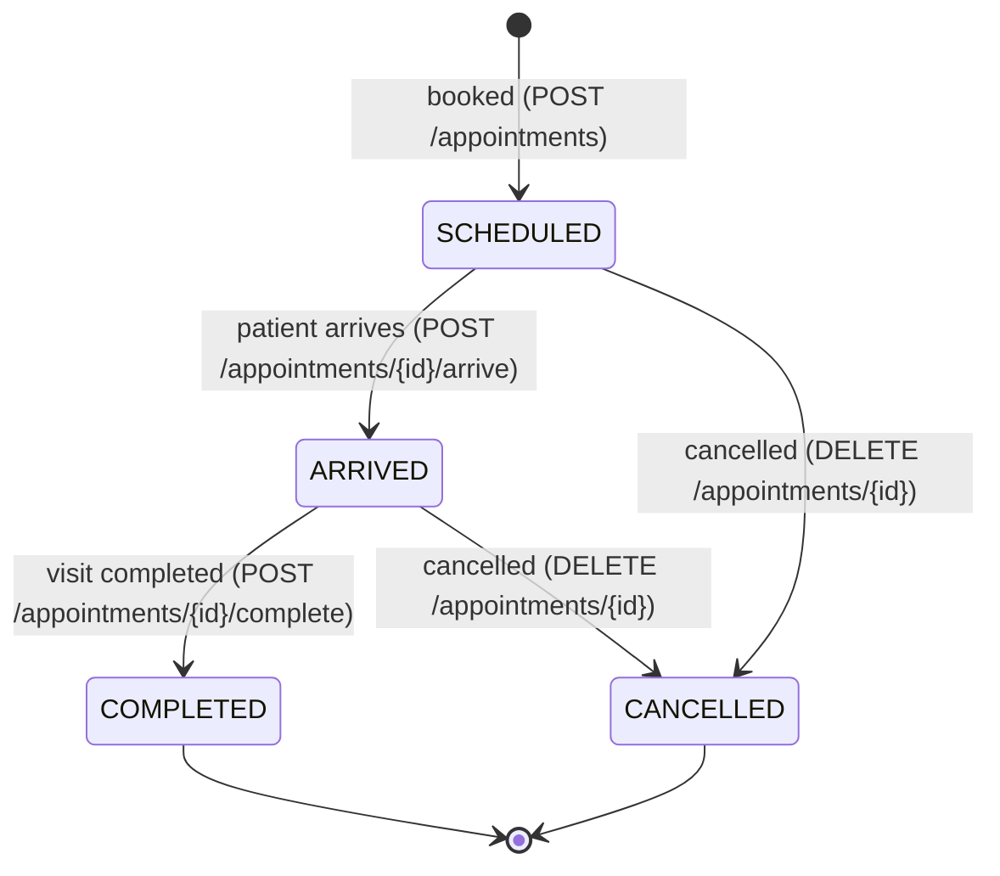

# API reference

The REST and Socket.IO API of the EMR appointment module. Everything here comes from the routes, zod validators, controllers, services and middlewares in `server/src`. Where this document and the code disagree, the code is right.

Every example in this document is a real request and response. They were recorded by running the API against an in-memory MongoDB on Sunday 2026-10-18, with bookings for Monday 2026-10-19. Ids, timestamps and request ids come from that run, and long tokens are shortened.

A Postman collection with every endpoint is in [`postman_collection.json`](postman_collection.json). The database behind the API is described in [`DATABASE_DESIGN.md`](DATABASE_DESIGN.md).

**Contents**

1. [Overview](#1-overview)
2. [Roles and permissions](#2-roles-and-permissions)
3. [Endpoints](#3-endpoints): [Auth](#auth), [Users](#users), [Doctors](#doctors), [Departments](#departments), [Patients](#patients), [Slots](#slots), [Appointments](#appointments), [Health](#health)
4. [Appointment status workflow](#4-appointment-status-workflow)
5. [Slot rules](#5-slot-rules)
6. [Concurrency](#6-concurrency)
7. [Pagination, sorting and filtering](#7-pagination-sorting-and-filtering)
8. [Real-time updates (Socket.IO)](#8-real-time-updates-socketio)
9. [Error reference and rate limits](#9-error-reference-and-rate-limits)

---

## 1. Overview

### Base URL

All paths in this document are relative to `/api/v1`. Locally the server listens on `PORT` (default `5000`), so the base URL is:

```
http://localhost:5000/api/v1
```

Requests and responses are JSON. Send `Content-Type: application/json` with every request body. A body can be at most 100 KB (`BODY_LIMIT`); a bigger one gets `413`. Cross-origin requests from a browser are allowed only from `CLIENT_URL` (default `http://localhost:5173`), with credentials.

### Authentication

The API uses two tokens:

| | Access token | Refresh token |
| --- | --- | --- |
| Where it comes from | `data.accessToken` in the [login](#post-authlogin) and [refresh](#post-authrefresh) responses | The `emr_refresh` cookie set by login and refresh |
| How to send it | `Authorization: Bearer <accessToken>` on every endpoint except `/health` and `/auth/*` | Automatically, as a cookie, to `/api/v1/auth/*` only |
| Lifetime | 15 minutes (`expiresIn: 900`, `JWT_ACCESS_TTL_SECONDS`) | 7 days (`REFRESH_TOKEN_TTL_DAYS`) |
| Where the client keeps it | In memory | Nowhere: the cookie is `HttpOnly`, so JavaScript can't read it |

- **Access token.** A JWT signed with HS256, issuer `emr-appointments-api`, audience `emr-access`. Its claims are `sub` (the user id), `role`, and `doctorId` for doctors. A missing, invalid or expired access token gets `401`.
- **Refresh token.** It is only ever sent in the cookie, never in a response body. The cookie is `HttpOnly; Secure; SameSite=Strict; Path=/api/v1/auth`. Every refresh rotates it: the old cookie stops working and a new one is set.
  - Browsers send it when a request includes credentials (`withCredentials: true` in axios, `credentials: 'include'` in `fetch`).
  - Because the cookie is `Secure`, clients send it only over HTTPS. curl 8.17 (tested) also sends it to `http://localhost` and `http://127.0.0.1`.

### Response format

Every response, success or error, has the same envelope:

| Field | Type | Meaning |
| --- | --- | --- |
| `success` | boolean | `true` for 2xx responses |
| `message` | string | A short human-readable result |
| `data` | object, array or `null` | The result. Always `null` for errors, except the `503` from `/health`. |
| `meta` | object | Pagination for lists (see [section 7](#7-pagination-sorting-and-filtering)), the request id and field errors for errors, otherwise `{}` |

A response without paging:

`200 OK`

```json
{
  "success": true,
  "message": "Departments retrieved",
  "data": [
    { "id": "6ad4b1a2c42b65083c36c4d8", "name": "Cardiology" },
    { "id": "6ad4b1a2c42b65083c36c4d9", "name": "Dermatology" },
    { "id": "6ad4b1a2c42b65083c36c4d7", "name": "General Medicine" },
    { "id": "6ad4b1a2c42b65083c36c4da", "name": "Orthopedics" },
    { "id": "6ad4b1a2c42b65083c36c4db", "name": "Pediatrics" }
  ],
  "meta": {}
}
```

A page of results puts the page numbers in `meta`:

`200 OK`

```json
{
  "success": true,
  "message": "Patients retrieved",
  "data": [
    {
      "id": "6ad4b1a6c42b65083c36c4f5",
      "patientCode": "PAT-000002",
      "name": "Ravi Kumar",
      "mobile": "9123456780",
      "gender": "MALE",
      "dateOfBirth": null
    }
  ],
  "meta": { "page": 1, "limit": 20, "total": 1, "totalPages": 1 }
}
```

### Error format

Errors use the same envelope with `success: false` and `data: null`. `meta.requestId` matches the `X-Request-Id` response header; quote it when reporting a problem. Validation errors also list every invalid field in `meta.errors`:

`400 Bad Request`

```json
{
  "success": false,
  "message": "Validation failed",
  "data": null,
  "meta": {
    "requestId": "02d8cf7c-5ab9-40f5-b426-20d76627c560",
    "errors": [
      { "field": "body.name", "message": "Required" },
      { "field": "body.email", "message": "Must be a valid email address" },
      { "field": "body.password", "message": "Must be at least 8 characters" },
      { "field": "body.password", "message": "Must contain a number" }
    ]
  }
}
```

`field` is the path of the bad input: `body.<field>`, `query.<parameter>` or `params.<name>`, with array positions as numbers, for example `body.schedule.0.sessions.1`. The same field can appear more than once, one entry per broken rule.

Requests without a valid access token get `401`, and requests from a role that isn't allowed get `403`. These two look the same on every endpoint:

`401 Unauthorized`

```json
{
  "success": false,
  "message": "Authentication required",
  "data": null,
  "meta": { "requestId": "229dd142-13d8-4ea3-bc26-c9cf97bc517b" }
}
```

`403 Forbidden`

```json
{
  "success": false,
  "message": "You do not have permission to perform this action",
  "data": null,
  "meta": { "requestId": "436a88a0-244f-482c-a95b-2d2816a31f98" }
}
```

The full list of status codes and messages is in [section 9](#9-error-reference-and-rate-limits).

### Request id

Every response has an `X-Request-Id` header. Send your own `X-Request-Id` (1 to 64 letters, digits, `_` or `-`) to trace a request through the logs; otherwise the server generates a UUID.

```http
HTTP/1.1 200 OK
X-Request-Id: front-desk-7f3a
```

### Input rules

These apply to every endpoint:

- **Ids** are MongoDB ObjectIds: 24 hexadecimal characters, in either case. Anything else gets `400` with `Must be a valid id`.
- **Dates** are `"YYYY-MM-DD"` and must be real calendar dates (`2026-02-30` is rejected). **Times** are `"HH:mm"` on a 24-hour clock. Both are wall-clock values in the clinic's timezone (`CLINIC_TIMEZONE`, default `Asia/Kolkata`).
- **Timestamps** in responses (`createdAt`, `arrivedAt` and so on) are ISO 8601 in UTC.
- **Text** fields are trimmed before their length is checked, except passwords.
- **Unknown body fields** are ignored. Body keys that start with `$` or contain `.` are removed before validation, so MongoDB operators can't be injected. A body nested more than 32 levels deep gets `400 Request body is nested too deeply`.
- **Query strings** are flat: `?a[b]=1` is not turned into an object. `?search[$gt]=x` is a parameter literally named `search[$gt]`, and like any **unknown query parameter** it is ignored: the request runs without it, and the answer is `200`.

### Order of checks

A request goes through these checks in order, and the first failure decides the response:

1. Parsing the JSON body: `400` for malformed JSON, `413` for an oversized body
2. Rate limits: `429`
3. Authentication: `401`
4. Role: `403`
5. Validation of the body, query and path: `400`
6. Business rules in the service: `403`, `404`, `409` or `422`

Because the role check comes before validation, a caller without access gets `403` even when the body or query is invalid.

---

## 2. Roles and permissions

There are three roles: `SUPER_ADMIN`, `RECEPTIONIST` and `DOCTOR`.

| Endpoint | SUPER_ADMIN | RECEPTIONIST | DOCTOR |
| --- | :---: | :---: | :---: |
| [`POST /auth/login`](#post-authlogin), [`POST /auth/refresh`](#post-authrefresh), [`POST /auth/logout`](#post-authlogout) | Public | Public | Public |
| [`POST /users/receptionists`](#post-usersreceptionists) | Yes | No | No |
| [`POST /doctors`](#post-doctors) | Yes | No | No |
| [`GET /doctors`](#get-doctors) | Yes | Yes | Own profile only |
| [`GET /doctors/:id`](#get-doctorsid) | Yes | Yes | Own profile only |
| [`PUT /doctors/:id/schedule`](#put-doctorsidschedule) | Yes | No | No |
| [`GET /departments`](#get-departments) | Yes | Yes | Yes |
| [`GET /patients`](#get-patients) | Yes | Yes | No |
| [`GET /slots`](#get-slots) | Yes | Yes | Own slots only |
| [`POST /appointments`](#post-appointments) | Yes | Yes | No |
| [`GET /appointments`](#get-appointments) | Yes | Yes | Own only |
| [`GET /appointments/:id`](#get-appointmentsid) | Yes | Yes | Own only |
| [`PUT /appointments/:id`](#put-appointmentsid) | Yes | Yes | Own only, `notes` only |
| [`DELETE /appointments/:id`](#delete-appointmentsid) | Yes | Yes | No |
| [`POST /appointments/:id/arrive`](#post-appointmentsidarrive) | Yes | Yes | No |
| [`POST /appointments/:id/complete`](#post-appointmentsidcomplete) | Yes | No | Own only |
| [`GET /health`](#get-health) | Public | Public | Public |

"No" means the request gets `403 You do not have permission to perform this action`.

### Doctor scoping

A doctor's access token carries `doctorId`, the id of their doctor profile. The services add it to every query a doctor makes, so a doctor can never reach another doctor's records:

- **Lists** (`GET /doctors`, `GET /appointments`) contain only the doctor's own records. The `doctorId` and `doctorName` filters of `GET /appointments` are ignored for doctors.
- **Single records** of another doctor answer `404`, exactly as if they didn't exist: `GET /doctors/:id`, `GET /appointments/:id`, `PUT /appointments/:id` and `POST /appointments/:id/complete`.
- **Slots** of another doctor answer `403 Doctors can only view their own slots`.
- **Socket.IO** rooms of another doctor are refused (see [section 8](#8-real-time-updates-socketio)).

---

## 3. Endpoints

To try the curl examples, set two shell variables. Take `ACCESS_TOKEN` from `data.accessToken` in the login response. The login example saves the refresh cookie to `cookies.txt`, and the refresh and logout examples use it.

```bash
BASE_URL=http://localhost:5000/api/v1
ACCESS_TOKEN=<data.accessToken from POST /auth/login>
```

### Auth

### POST /auth/login

Logs in with an email and password. Returns an access token and sets the refresh cookie.

- **Roles:** public
- **Headers:** `Content-Type: application/json`
- **Rate limit:** 10 failed attempts per IP address per 15 minutes, on top of the [global limit](#rate-limits)
- **Audit:** a `LOGIN` entry, or `LOGIN_FAILED` with the reason, naming the user and their role. A failed login with an unknown email has no user, so its entry records only the email tried.

**Body**

| Field | Type | Required | Rules |
| --- | --- | --- | --- |
| `email` | string | yes | A valid email address, at most 254 characters. Trimmed and lowercased first, so it is not case-sensitive. |
| `password` | string | yes | 1 to 72 characters. No strength rules at login. |

**Example request**

The examples use accounts from the recording run. Log in with the Super Admin you created with `npm run seed` (`SEED_ADMIN_EMAIL` and `SEED_ADMIN_PASSWORD`); there is no default password.

```bash
curl -X POST "$BASE_URL/auth/login" \
  -c cookies.txt \
  -H "Content-Type: application/json" \
  -d '{
    "email": "admin@clinic.example",
    "password": "Admin@12345"
  }'
```

**Success response**

`200 OK`

```json
{
  "success": true,
  "message": "Logged in successfully",
  "data": {
    "accessToken": "eyJhbGciOiJIUzI1NiIsInR5cCI6IkpXVCJ9.eyJyb2xlIjoiU1VQ…",
    "tokenType": "Bearer",
    "expiresIn": 900,
    "user": {
      "id": "6ad4b1a3c42b65083c36c4dc",
      "name": "Super Admin",
      "email": "admin@clinic.example",
      "role": "SUPER_ADMIN"
    }
  },
  "meta": {}
}
```

It also sets the refresh cookie:

```http
Set-Cookie: emr_refresh=<refresh token>; Path=/api/v1/auth; Expires=Sun, 25 Oct 2026 11:46:43 GMT; HttpOnly; Secure; SameSite=Strict
```

For a doctor, `data.user` also has `doctorId`, the id of their doctor profile:

```json
{
  "id": "6ad4b1a4c42b65083c36c4e5",
  "name": "Dr. Kavya Mehta",
  "email": "kavya.mehta@clinic.example",
  "role": "DOCTOR",
  "doctorId": "6ad4b1a4c42b65083c36c4e6"
}
```

**Error responses**

| Status | `message` | When |
| --- | --- | --- |
| 400 | `Validation failed` | The body breaks a rule above |
| 401 | `Invalid email or password` | The email is unknown, the password is wrong, or the account is deactivated. The message is the same for all three, so it never reveals which emails have accounts. |
| 429 | `Too many requests, please try again later` | 10 failed attempts from this IP address in 15 minutes. Any response with status 400 or above counts as a failure. |

<details>
<summary>Example error responses</summary>

`400 Bad Request`

```json
{
  "success": false,
  "message": "Validation failed",
  "data": null,
  "meta": {
    "requestId": "92979bbb-47d5-4227-94e3-8a8929b9a4af",
    "errors": [
      { "field": "body.email", "message": "Must be a valid email address" },
      { "field": "body.password", "message": "Required" }
    ]
  }
}
```

`401 Unauthorized`

```json
{
  "success": false,
  "message": "Invalid email or password",
  "data": null,
  "meta": { "requestId": "05f7d6aa-808d-4401-8c69-b1047f96b9e2" }
}
```

`429 Too Many Requests`

```json
{
  "success": false,
  "message": "Too many requests, please try again later",
  "data": null,
  "meta": { "requestId": "e6a70a62-b329-4ee7-af2f-ec9333cf9380" }
}
```

</details>

### POST /auth/refresh

Exchanges the refresh cookie for a new access token and a new refresh cookie. Each refresh token works once.

- **Roles:** public; needs the `emr_refresh` cookie
- **Headers:** `Cookie: emr_refresh=<refresh token>`, which browsers and cookie jars send automatically
- **Body:** none

**Example request**

```bash
curl -X POST "$BASE_URL/auth/refresh" \
  -b cookies.txt -c cookies.txt
```

**Success response**

The same `data` as login, with a new access token:

`200 OK`

```json
{
  "success": true,
  "message": "Session refreshed",
  "data": {
    "accessToken": "eyJhbGciOiJIUzI1NiIsInR5cCI6IkpXVCJ9.eyJyb2xlIjoiU1VQ…",
    "tokenType": "Bearer",
    "expiresIn": 900,
    "user": {
      "id": "6ad4b1a3c42b65083c36c4dc",
      "name": "Super Admin",
      "email": "admin@clinic.example",
      "role": "SUPER_ADMIN"
    }
  },
  "meta": {}
}
```

```http
Set-Cookie: emr_refresh=<refresh token>; Path=/api/v1/auth; Expires=Sun, 25 Oct 2026 11:46:47 GMT; HttpOnly; Secure; SameSite=Strict
```

**Error responses**

Every failure with a cookie also clears it (`Set-Cookie: emr_refresh=; ... Expires=Thu, 01 Jan 1970 00:00:00 GMT`), because a refresh cookie that failed once never works again. A request without the cookie leaves the browser's cookie alone.

A request whose `Origin` header names another site, or is the literal `null` that sandboxed frames send, gets `403 Cross-site requests are not allowed`, so no other page can use the cookie. Requests without `Origin` (curl, Postman, another server) are not affected: they carry no browser cookie that a forged request could borrow.

| Status | `message` | When |
| --- | --- | --- |
| 401 | `Refresh token missing` | No `emr_refresh` cookie |
| 403 | `Cross-site requests are not allowed` | The `Origin` header is not `CLIENT_URL` |
| 401 | `Invalid token` | The cookie is not a valid refresh token |
| 401 | `Token has expired` | The refresh token is older than 7 days |
| 401 | `Your session has expired, please log in again` | The token is unknown or revoked, or the user is deactivated. A token that was already revoked, by logout or by an earlier refresh, is treated as stolen: every session of that user is revoked, and a `REFRESH_TOKEN_REUSE` audit entry names the user and their role. |

<details>
<summary>Example error responses</summary>

`401 Unauthorized`

```json
{
  "success": false,
  "message": "Refresh token missing",
  "data": null,
  "meta": { "requestId": "82f6ad45-ed19-47e4-99e7-5da8853442f2" }
}
```

`401 Unauthorized`, with a cookie that isn't a valid refresh token. The cookie is cleared:

```json
{
  "success": false,
  "message": "Invalid token",
  "data": null,
  "meta": { "requestId": "f2bbbf77-701b-4368-bb1c-7d68038faec3" }
}
```

```http
Set-Cookie: emr_refresh=; Path=/api/v1/auth; Expires=Thu, 01 Jan 1970 00:00:00 GMT; HttpOnly; Secure; SameSite=Strict
```

A refresh token that was already rotated. After this, even the newest token of the same user is refused:

`401 Unauthorized`

```json
{
  "success": false,
  "message": "Your session has expired, please log in again",
  "data": null,
  "meta": { "requestId": "ffe18b94-598a-497e-b9e8-00f65dc7a765" }
}
```

</details>

### POST /auth/logout

Revokes the refresh token in the cookie and clears the cookie. It succeeds even without a cookie, and then sets no cookie. The access token stays valid until it expires, so the client should also drop it.

- **Roles:** public; the `emr_refresh` cookie is optional
- **Body:** none
- **Audit:** a `LOGOUT` entry naming the user and their role, when the cookie names a live session. The role is looked up from the user, because a refresh token records only the user id.

**Example request**

```bash
curl -X POST "$BASE_URL/auth/logout" \
  -b cookies.txt -c cookies.txt
```

**Success response**

`200 OK`

```json
{
  "success": true,
  "message": "Logged out successfully",
  "data": null,
  "meta": {}
}
```

```http
Set-Cookie: emr_refresh=; Path=/api/v1/auth; Expires=Thu, 01 Jan 1970 00:00:00 GMT; HttpOnly; Secure; SameSite=Strict
```

**Error responses:** `403 Cross-site requests are not allowed` when the `Origin` header names another site (the literal origin `null` included), as for [refresh](#post-authrefresh), and the [rate limit](#rate-limits). Requests without an `Origin` header, such as curl's, are not affected.

### Users

### POST /users/receptionists

Creates a receptionist account. Doctors are created with [`POST /doctors`](#post-doctors), and the first Super Admin with the seed script (`npm run seed`).

- **Roles:** SUPER_ADMIN
- **Headers:** `Authorization: Bearer <accessToken>`, `Content-Type: application/json`

**Body**

| Field | Type | Required | Rules |
| --- | --- | --- | --- |
| `name` | string | yes | 1 to 100 characters after trimming |
| `email` | string | yes | A valid email address, at most 254 characters. Stored lowercase, and must not be used by another account. |
| `password` | string | yes | 8 to 72 characters, with at least one letter and one number |

**Example request**

```bash
# ACCESS_TOKEN belongs to a SUPER_ADMIN
curl -X POST "$BASE_URL/users/receptionists" \
  -H "Authorization: Bearer $ACCESS_TOKEN" \
  -H "Content-Type: application/json" \
  -d '{
    "name": "Priya Nair",
    "email": "priya.nair@clinic.example",
    "password": "Welcome123"
  }'
```

**Success response**

`201 Created`

```json
{
  "success": true,
  "message": "Receptionist created",
  "data": {
    "id": "6ad4b1a4c42b65083c36c4e0",
    "name": "Priya Nair",
    "email": "priya.nair@clinic.example",
    "role": "RECEPTIONIST"
  },
  "meta": {}
}
```

**Error responses**

| Status | `message` | When |
| --- | --- | --- |
| 400 | `Validation failed` | The body breaks a rule above |
| 401 | `Authentication required` | No valid access token |
| 403 | `You do not have permission to perform this action` | The caller is not a SUPER_ADMIN |
| 409 | `A record with the same email already exists` | The email is taken. Emails are compared without case. |

<details>
<summary>Example error responses</summary>

`400 Bad Request`

```json
{
  "success": false,
  "message": "Validation failed",
  "data": null,
  "meta": {
    "requestId": "02d8cf7c-5ab9-40f5-b426-20d76627c560",
    "errors": [
      { "field": "body.name", "message": "Required" },
      { "field": "body.email", "message": "Must be a valid email address" },
      { "field": "body.password", "message": "Must be at least 8 characters" },
      { "field": "body.password", "message": "Must contain a number" }
    ]
  }
}
```

`401 Unauthorized`

```json
{
  "success": false,
  "message": "Authentication required",
  "data": null,
  "meta": { "requestId": "d84243cd-aa0d-4b17-9bbf-3e1dcdd0ea0b" }
}
```

`403 Forbidden`

```json
{
  "success": false,
  "message": "You do not have permission to perform this action",
  "data": null,
  "meta": { "requestId": "436a88a0-244f-482c-a95b-2d2816a31f98" }
}
```

`409 Conflict`

```json
{
  "success": false,
  "message": "A record with the same email already exists",
  "data": null,
  "meta": { "requestId": "bb902fe0-6d96-4325-a271-e0abb1b998f4" }
}
```

</details>

### Doctors

### POST /doctors

Creates a doctor: the user account the doctor logs in with, and the doctor profile, saved together in one transaction.

- **Roles:** SUPER_ADMIN
- **Headers:** `Authorization: Bearer <accessToken>`, `Content-Type: application/json`

**Body**

| Field | Type | Required | Rules |
| --- | --- | --- | --- |
| `name` | string | yes | 1 to 100 characters after trimming. Used for both the account and the profile. |
| `email` | string | yes | A valid email address, at most 254 characters, not used by another account |
| `password` | string | yes | 8 to 72 characters, with at least one letter and one number |
| `departmentId` | string (id) | yes | Must be an existing department (`422` otherwise) |
| `specialization` | string | yes | 1 to 100 characters after trimming |
| `slotDurationMinutes` | integer | yes | 5 to 240 |
| `schedule` | array | no | The weekly schedule, at most 7 days. Default `[]`: no working days. |
| `schedule[].dayOfWeek` | integer | yes | 0 (Sunday) to 6 (Saturday). Each day at most once. |
| `schedule[].sessions` | array of `{ start, end }` | yes | Working hours, `"HH:mm"`. At least 1 and at most 8 per day. |
| `schedule[].breaks` | array of `{ start, end }` | no | At most 8. Default `[]`. |

**Schedule rules.** A schedule that breaks any of these gets `400`, with one `meta.errors` entry per problem:

- Every range starts before it ends. Ranges are half-open, so `09:00-12:00` and `12:00-13:00` touch without overlapping.
- A day's sessions don't overlap each other, and neither do its breaks.
- Each break falls within the day's working hours, from the first session's start to the last session's end. A break can cut into a session or sit in the gap between two sessions.

**Example request**

```bash
# ACCESS_TOKEN belongs to a SUPER_ADMIN
curl -X POST "$BASE_URL/doctors" \
  -H "Authorization: Bearer $ACCESS_TOKEN" \
  -H "Content-Type: application/json" \
  -d '{
    "name": "Dr. Kavya Mehta",
    "email": "kavya.mehta@clinic.example",
    "password": "Welcome123",
    "departmentId": "6ad4b1a2c42b65083c36c4d8",
    "specialization": "Interventional Cardiology",
    "slotDurationMinutes": 15,
    "schedule": [
      {
        "dayOfWeek": 1,
        "sessions": [
          {
            "start": "09:00",
            "end": "12:00"
          },
          {
            "start": "13:00",
            "end": "17:00"
          }
        ],
        "breaks": [
          {
            "start": "12:00",
            "end": "13:00"
          }
        ]
      },
      {
        "dayOfWeek": 3,
        "sessions": [
          {
            "start": "10:00",
            "end": "14:00"
          }
        ],
        "breaks": []
      }
    ]
  }'
```

**Success response**

`201 Created`

```json
{
  "success": true,
  "message": "Doctor created",
  "data": {
    "id": "6ad4b1a4c42b65083c36c4e6",
    "userId": "6ad4b1a4c42b65083c36c4e5",
    "name": "Dr. Kavya Mehta",
    "specialization": "Interventional Cardiology",
    "department": { "id": "6ad4b1a2c42b65083c36c4d8", "name": "Cardiology" },
    "slotDurationMinutes": 15,
    "schedule": [
      {
        "dayOfWeek": 1,
        "sessions": [{ "start": "09:00", "end": "12:00" }, { "start": "13:00", "end": "17:00" }],
        "breaks": [{ "start": "12:00", "end": "13:00" }]
      },
      { "dayOfWeek": 3, "sessions": [{ "start": "10:00", "end": "14:00" }], "breaks": [] }
    ]
  },
  "meta": {}
}
```

**Error responses**

| Status | `message` | When |
| --- | --- | --- |
| 400 | `Validation failed` | The body or the schedule breaks a rule above |
| 401 | `Authentication required` | No valid access token |
| 403 | `You do not have permission to perform this action` | The caller is not a SUPER_ADMIN |
| 409 | `A record with the same email already exists` | The email is taken. Nothing is saved. |
| 422 | `Department not found` | `departmentId` is not an existing department |

<details>
<summary>Example error responses</summary>

`400 Bad Request`

```json
{
  "success": false,
  "message": "Validation failed",
  "data": null,
  "meta": {
    "requestId": "c2ab90cf-9a75-451c-b406-f7c1923c4bd8",
    "errors": [
      { "field": "body.schedule.0.sessions.1", "message": "Sessions 09:00-12:00 and 11:00-14:00 overlap" },
      {
        "field": "body.schedule.0.breaks.0",
        "message": "Break 18:00-18:30 must fall within working hours 09:00-14:00"
      }
    ]
  }
}
```

`403 Forbidden`

```json
{
  "success": false,
  "message": "You do not have permission to perform this action",
  "data": null,
  "meta": { "requestId": "7c2aa58a-f75d-429b-9801-af50f3156cca" }
}
```

`409 Conflict`

```json
{
  "success": false,
  "message": "A record with the same email already exists",
  "data": null,
  "meta": { "requestId": "70e11209-df6e-4bd0-aae2-4490a51c2827" }
}
```

`422 Unprocessable Entity`

```json
{
  "success": false,
  "message": "Department not found",
  "data": null,
  "meta": { "requestId": "eecce131-9cd3-4989-a56f-10d3f0cd058f" }
}
```

</details>

### GET /doctors

Lists doctors, sorted by name.

- **Roles:** all; a DOCTOR only gets their own profile
- **Headers:** `Authorization: Bearer <accessToken>`

**Query parameters**

| Parameter | Type | Default | Rules |
| --- | --- | --- | --- |
| `departmentId` | string (id) | | Only doctors in this department |
| `search` | string | | 1 to 100 characters. Matches anywhere in the name or the specialization, ignoring case. |
| `page` | integer | `1` | At least 1 |
| `limit` | integer | `20` | 1 to 100 |

**Example request**

```bash
# ACCESS_TOKEN belongs to a RECEPTIONIST
curl "$BASE_URL/doctors?departmentId=6ad4b1a2c42b65083c36c4d8&search=cardio&page=1&limit=10" \
  -H "Authorization: Bearer $ACCESS_TOKEN"
```

**Success response**

`200 OK`

```json
{
  "success": true,
  "message": "Doctors retrieved",
  "data": [
    {
      "id": "6ad4b1a4c42b65083c36c4e6",
      "userId": "6ad4b1a4c42b65083c36c4e5",
      "name": "Dr. Kavya Mehta",
      "specialization": "Interventional Cardiology",
      "department": { "id": "6ad4b1a2c42b65083c36c4d8", "name": "Cardiology" },
      "slotDurationMinutes": 15,
      "schedule": [
        {
          "dayOfWeek": 1,
          "sessions": [{ "start": "09:00", "end": "12:00" }, { "start": "13:00", "end": "17:00" }],
          "breaks": [{ "start": "12:00", "end": "13:00" }]
        },
        { "dayOfWeek": 3, "sessions": [{ "start": "10:00", "end": "14:00" }], "breaks": [] }
      ]
    }
  ],
  "meta": { "page": 1, "limit": 10, "total": 1, "totalPages": 1 }
}
```

**Error responses**

| Status | `message` | When |
| --- | --- | --- |
| 400 | `Validation failed` | A query parameter breaks a rule above |
| 401 | `Authentication required` | No valid access token |

<details>
<summary>Example error response</summary>

`400 Bad Request`

```json
{
  "success": false,
  "message": "Validation failed",
  "data": null,
  "meta": {
    "requestId": "85cc527b-8e6e-422a-9c27-06c4133e1d6a",
    "errors": [{ "field": "query.limit", "message": "Too big: expected number to be <=100" }]
  }
}
```

</details>

### GET /doctors/:id

Returns one doctor.

- **Roles:** all; a DOCTOR only their own profile
- **Headers:** `Authorization: Bearer <accessToken>`
- **Path parameters:** `id`, the doctor's id

**Example request**

```bash
# ACCESS_TOKEN belongs to a RECEPTIONIST
curl "$BASE_URL/doctors/6ad4b1a4c42b65083c36c4e6" \
  -H "Authorization: Bearer $ACCESS_TOKEN"
```

**Success response**

`200 OK`

```json
{
  "success": true,
  "message": "Doctor retrieved",
  "data": {
    "id": "6ad4b1a4c42b65083c36c4e6",
    "userId": "6ad4b1a4c42b65083c36c4e5",
    "name": "Dr. Kavya Mehta",
    "specialization": "Interventional Cardiology",
    "department": { "id": "6ad4b1a2c42b65083c36c4d8", "name": "Cardiology" },
    "slotDurationMinutes": 15,
    "schedule": [
      {
        "dayOfWeek": 1,
        "sessions": [{ "start": "09:00", "end": "12:00" }, { "start": "13:00", "end": "17:00" }],
        "breaks": [{ "start": "12:00", "end": "13:00" }]
      },
      { "dayOfWeek": 3, "sessions": [{ "start": "10:00", "end": "14:00" }], "breaks": [] }
    ]
  },
  "meta": {}
}
```

**Error responses**

| Status | `message` | When |
| --- | --- | --- |
| 400 | `Validation failed` | `id` is not a valid id |
| 401 | `Authentication required` | No valid access token |
| 404 | `Doctor not found` | No such doctor, or a DOCTOR asked for another doctor's profile |

<details>
<summary>Example error responses</summary>

`400 Bad Request`

```json
{
  "success": false,
  "message": "Validation failed",
  "data": null,
  "meta": {
    "requestId": "9c9daa41-b989-4068-bf73-04290bfb6472",
    "errors": [{ "field": "params.id", "message": "Must be a valid id" }]
  }
}
```

`404 Not Found`

```json
{
  "success": false,
  "message": "Doctor not found",
  "data": null,
  "meta": { "requestId": "8d01fe2c-9b59-4e57-ae50-261fd57c1d04" }
}
```

</details>

### PUT /doctors/:id/schedule

Replaces a doctor's whole weekly schedule and, optionally, the slot length. A change that would leave a booked appointment without its slot is refused with `409`, listing those appointments. Here, "without its slot" means that no slot in the new grid has the appointment's date, start **and** end. Only appointments still to happen count: SCHEDULED or ARRIVED, dated today or later. Completed, cancelled and earlier appointments never block a change.

- **Roles:** SUPER_ADMIN
- **Headers:** `Authorization: Bearer <accessToken>`, `Content-Type: application/json`
- **Path parameters:** `id`, the doctor's id

**Body**

| Field | Type | Required | Rules |
| --- | --- | --- | --- |
| `schedule` | array | yes | The new weekly schedule, with the same fields and [schedule rules](#post-doctors) as when creating a doctor. `[]` removes every working day. |
| `slotDurationMinutes` | integer | no | 5 to 240. Unchanged if left out. |

**Example request**

```bash
# ACCESS_TOKEN belongs to a SUPER_ADMIN
curl -X PUT "$BASE_URL/doctors/6ad4b1a4c42b65083c36c4e6/schedule" \
  -H "Authorization: Bearer $ACCESS_TOKEN" \
  -H "Content-Type: application/json" \
  -d '{
    "schedule": [
      {
        "dayOfWeek": 1,
        "sessions": [
          {
            "start": "09:00",
            "end": "12:00"
          },
          {
            "start": "13:00",
            "end": "17:00"
          }
        ],
        "breaks": [
          {
            "start": "12:00",
            "end": "13:00"
          }
        ]
      },
      {
        "dayOfWeek": 3,
        "sessions": [
          {
            "start": "10:00",
            "end": "14:00"
          }
        ],
        "breaks": []
      },
      {
        "dayOfWeek": 5,
        "sessions": [
          {
            "start": "09:00",
            "end": "13:00"
          }
        ],
        "breaks": []
      }
    ],
    "slotDurationMinutes": 15
  }'
```

**Success response**

`200 OK`

```json
{
  "success": true,
  "message": "Schedule updated",
  "data": {
    "id": "6ad4b1a4c42b65083c36c4e6",
    "userId": "6ad4b1a4c42b65083c36c4e5",
    "name": "Dr. Kavya Mehta",
    "specialization": "Interventional Cardiology",
    "department": { "id": "6ad4b1a2c42b65083c36c4d8", "name": "Cardiology" },
    "slotDurationMinutes": 15,
    "schedule": [
      {
        "dayOfWeek": 1,
        "sessions": [{ "start": "09:00", "end": "12:00" }, { "start": "13:00", "end": "17:00" }],
        "breaks": [{ "start": "12:00", "end": "13:00" }]
      },
      { "dayOfWeek": 3, "sessions": [{ "start": "10:00", "end": "14:00" }], "breaks": [] },
      { "dayOfWeek": 5, "sessions": [{ "start": "09:00", "end": "13:00" }], "breaks": [] }
    ]
  },
  "meta": {}
}
```

**Error responses**

| Status | `message` | When |
| --- | --- | --- |
| 400 | `Validation failed` | The body or the schedule breaks a rule |
| 401 | `Authentication required` | No valid access token |
| 403 | `You do not have permission to perform this action` | The caller is not a SUPER_ADMIN |
| 404 | `Doctor not found` | No doctor with this id |
| 409 | `This schedule would leave <n> booked appointment(s) without their slot(s)` | The new grid has no slot with the same date, start and end for a SCHEDULED or ARRIVED appointment dated today or later. `meta.appointments` lists them. Nothing is saved. |

A change saved at the same moment as a booking for a slot it removes is caught too. The change re-checks the appointments once saved, and puts the previous schedule back if a booking it missed would be stranded. The booking re-checks its slot once saved, and is undone with `422` if the slot is gone.

<details>
<summary>Example error responses</summary>

`409 Conflict`

```json
{
  "success": false,
  "message": "This schedule would leave 1 booked appointment without its slot",
  "data": null,
  "meta": {
    "requestId": "5b0d6e57-2a3c-4b5f-9d1e-7f0a4c2b8e11",
    "appointments": [
      {
        "id": "6ad52b9e5099159b77ebd84e",
        "date": "2026-10-23",
        "slotStart": "10:30",
        "slotEnd": "11:00",
        "status": "SCHEDULED",
        "patient": { "id": "6ad52b9e5099159b77ebd84f", "patientCode": "PAT-000025", "name": "Pooja Nair" }
      }
    ]
  }
}
```

`400 Bad Request`

```json
{
  "success": false,
  "message": "Validation failed",
  "data": null,
  "meta": {
    "requestId": "8477cb5a-c838-48b8-9337-949ec888f473",
    "errors": [
      { "field": "body.schedule.0.dayOfWeek", "message": "Too big: expected number to be <=6" },
      { "field": "body.schedule.0.sessions.0.start", "message": "Must be a time in HH:mm format" },
      { "field": "body.schedule.0.dayOfWeek", "message": "dayOfWeek must be 0 (Sunday) to 6 (Saturday)" },
      { "field": "body.schedule.0.sessions.0", "message": "Times must use the HH:mm format" }
    ]
  }
}
```

`403 Forbidden`

```json
{
  "success": false,
  "message": "You do not have permission to perform this action",
  "data": null,
  "meta": { "requestId": "d2ba8164-1c51-4564-b3df-3c498bcb7ab5" }
}
```

`404 Not Found`

```json
{
  "success": false,
  "message": "Doctor not found",
  "data": null,
  "meta": { "requestId": "df3fbcfa-9eb6-4a76-ac3a-ca1fcf74ba84" }
}
```

</details>

### Departments

### GET /departments

Lists every department, sorted by name without regard to case. Not paginated. Departments are created by the seed script (`SEED_DEPARTMENTS`); there is no endpoint to create them.

- **Roles:** all
- **Headers:** `Authorization: Bearer <accessToken>`

**Example request**

```bash
# ACCESS_TOKEN belongs to a RECEPTIONIST
curl "$BASE_URL/departments" \
  -H "Authorization: Bearer $ACCESS_TOKEN"
```

**Success response**

`200 OK`

```json
{
  "success": true,
  "message": "Departments retrieved",
  "data": [
    { "id": "6ad4b1a2c42b65083c36c4d8", "name": "Cardiology" },
    { "id": "6ad4b1a2c42b65083c36c4d9", "name": "Dermatology" },
    { "id": "6ad4b1a2c42b65083c36c4d7", "name": "General Medicine" },
    { "id": "6ad4b1a2c42b65083c36c4da", "name": "Orthopedics" },
    { "id": "6ad4b1a2c42b65083c36c4db", "name": "Pediatrics" }
  ],
  "meta": {}
}
```

**Error responses**

| Status | `message` | When |
| --- | --- | --- |
| 401 | `Authentication required` | No valid access token |

<details>
<summary>Example error response</summary>

`401 Unauthorized`

```json
{
  "success": false,
  "message": "Authentication required",
  "data": null,
  "meta": { "requestId": "bda98f6c-4a9f-4892-9593-ce6b96e944d3" }
}
```

</details>

### Patients

### GET /patients

Searches registered patients, sorted by name. Patients are registered by [`POST /appointments`](#post-appointments) with `newPatient`; there is no separate endpoint to create them.

- **Roles:** SUPER_ADMIN, RECEPTIONIST
- **Headers:** `Authorization: Bearer <accessToken>`

**Query parameters**

| Parameter | Type | Default | Rules |
| --- | --- | --- | --- |
| `search` | string | | 1 to 100 characters. Read as one of three kinds of term (see below). Leave it out to list every patient. |
| `page` | integer | `1` | At least 1 |
| `limit` | integer | `20` | 1 to 100 |

`search` is read as:

1. **A patient code** such as `PAT-000042`, in any case: an exact match.
2. **The start of a mobile number**, when it has only digits, spaces, `+`, `(`, `)`, `.` and `-`, and at least one digit. Separators and a `+91` prefix are removed first, so `+91 98765` finds `9876543210`.
3. **Words of the name** otherwise. Each word typed must be the start of a word of the name, in any order, ignoring case and the accents of Latin letters: `rao`, `Asha Rao`, `rao asha` and `a r` all find "Asha Rao", and `jose` finds "José Álvarez". Words are split at spaces and at `-`, `.`, `,`, `'` and `/`. A term with no words, such as `--`, finds nobody.

**Example request**

```bash
# ACCESS_TOKEN belongs to a RECEPTIONIST
curl "$BASE_URL/patients?search=98765" \
  -H "Authorization: Bearer $ACCESS_TOKEN"
```

**Success response**

`200 OK`

```json
{
  "success": true,
  "message": "Patients retrieved",
  "data": [
    {
      "id": "6ad4b1a6c42b65083c36c4f1",
      "patientCode": "PAT-000001",
      "name": "Asha Rao",
      "mobile": "9876543210",
      "gender": "FEMALE",
      "dateOfBirth": "1990-05-14"
    }
  ],
  "meta": { "page": 1, "limit": 20, "total": 1, "totalPages": 1 }
}
```

**Error responses**

| Status | `message` | When |
| --- | --- | --- |
| 400 | `Validation failed` | A query parameter breaks a rule above |
| 401 | `Authentication required` | No valid access token |
| 403 | `You do not have permission to perform this action` | The caller is a DOCTOR |

<details>
<summary>Example error responses</summary>

`400 Bad Request`

```json
{
  "success": false,
  "message": "Validation failed",
  "data": null,
  "meta": {
    "requestId": "5b1e7a62-e2bd-4884-9c45-f2e768620a26",
    "errors": [{ "field": "query.limit", "message": "Too big: expected number to be <=100" }]
  }
}
```

`403 Forbidden`

```json
{
  "success": false,
  "message": "You do not have permission to perform this action",
  "data": null,
  "meta": { "requestId": "2aaef535-2046-453b-b8ef-841812348bfc" }
}
```

</details>

### Slots

### GET /slots

Returns one doctor's slot grid for one date: every slot their schedule offers that day, each marked `AVAILABLE`, `BOOKED` or `PAST`. How slots are made is described in [section 5](#5-slot-rules).

- **Roles:** all; a DOCTOR only their own slots
- **Headers:** `Authorization: Bearer <accessToken>`

**Query parameters**

| Parameter | Type | Default | Rules |
| --- | --- | --- | --- |
| `doctorId` | string (id) | required | The doctor |
| `date` | string | required | `"YYYY-MM-DD"`, today or later in the clinic's timezone |
| `departmentId` | string (id) | | If given, the doctor must belong to this department |

**Example request**

```bash
# ACCESS_TOKEN belongs to a RECEPTIONIST
curl "$BASE_URL/slots?doctorId=6ad4b1a4c42b65083c36c4e6&date=2026-10-19" \
  -H "Authorization: Bearer $ACCESS_TOKEN"
```

**Success response**

The 10:30 slot is `AVAILABLE` because its appointment was cancelled. The 10:00 appointment is completed, and still holds its slot.

`200 OK`

```jsonc
{
  "success": true,
  "message": "Slots retrieved",
  "data": {
    "doctorId": "6ad4b1a4c42b65083c36c4e6",
    "date": "2026-10-19",
    "timezone": "Asia/Kolkata",
    "slotDurationMinutes": 15,
    "slots": [
      { "start": "09:00", "end": "09:15", "status": "AVAILABLE" },
      // … 3 more AVAILABLE slots, 09:15 to 09:45
      { "start": "10:00", "end": "10:15", "status": "BOOKED", "appointmentId": "6ad4b1a6c42b65083c36c4f2" },
      { "start": "10:15", "end": "10:30", "status": "AVAILABLE" },
      { "start": "10:30", "end": "10:45", "status": "AVAILABLE" },
      { "start": "10:45", "end": "11:00", "status": "AVAILABLE" },
      { "start": "11:00", "end": "11:15", "status": "BOOKED", "appointmentId": "6ad4b1a6c42b65083c36c4fb" },
      { "start": "11:15", "end": "11:30", "status": "AVAILABLE" },
      { "start": "11:30", "end": "11:45", "status": "BOOKED", "appointmentId": "6ad4b1a6c42b65083c36c4f9" },
      { "start": "11:45", "end": "12:00", "status": "AVAILABLE" },
      // no slots from 12:00 to 13:00
      { "start": "13:00", "end": "13:15", "status": "AVAILABLE" }
      // … 15 more AVAILABLE slots, 13:15 to 16:45
    ]
  },
  "meta": {}
}
```

| Field | Meaning |
| --- | --- |
| `timezone` | The clinic's timezone; every date and time in the grid is a wall-clock value there |
| `slots[].start`, `slots[].end` | `"HH:mm"`. A slot covers `[start, end)`. |
| `slots[].status` | `AVAILABLE`, `BOOKED` or `PAST` |
| `slots[].appointmentId` | Only on `BOOKED` slots: the appointment holding it |

A date the doctor doesn't work on returns an empty grid:

`200 OK`

```json
{
  "success": true,
  "message": "Slots retrieved",
  "data": {
    "doctorId": "6ad4b1a4c42b65083c36c4e6",
    "date": "2026-10-20",
    "timezone": "Asia/Kolkata",
    "slotDurationMinutes": 15,
    "slots": []
  },
  "meta": {}
}
```

**Error responses**

| Status | `message` | When |
| --- | --- | --- |
| 400 | `Validation failed` | A query parameter is missing or invalid |
| 401 | `Authentication required` | No valid access token |
| 403 | `Doctors can only view their own slots` | A DOCTOR asked for another doctor's slots |
| 404 | `Doctor not found` | No doctor with this id |
| 404 | `Doctor not found in this department` | `departmentId` is not the doctor's department |
| 422 | `Slots cannot be shown for a past date` | `date` is before today in the clinic's timezone |

<details>
<summary>Example error responses</summary>

`400 Bad Request`

```json
{
  "success": false,
  "message": "Validation failed",
  "data": null,
  "meta": {
    "requestId": "b4675c86-8efa-4c72-897e-92dc57b37ed5",
    "errors": [{ "field": "query.date", "message": "Invalid input: expected string, received undefined" }]
  }
}
```

`403 Forbidden`

```json
{
  "success": false,
  "message": "Doctors can only view their own slots",
  "data": null,
  "meta": { "requestId": "d5ec8dd7-d816-453e-b0f6-86f1dc78773b" }
}
```

`404 Not Found`

```json
{
  "success": false,
  "message": "Doctor not found",
  "data": null,
  "meta": { "requestId": "e49d1908-efe7-402d-97ee-e2cd7186e44f" }
}
```

`404 Not Found`

```json
{
  "success": false,
  "message": "Doctor not found in this department",
  "data": null,
  "meta": { "requestId": "449b1757-300a-4fd6-a27f-5cde0d76ca57" }
}
```

`422 Unprocessable Entity`

```json
{
  "success": false,
  "message": "Slots cannot be shown for a past date",
  "data": null,
  "meta": { "requestId": "a4e8e8dd-2b7f-45de-bee0-3279119b24ed" }
}
```

</details>

### Appointments

### POST /appointments

Books a slot. The patient is either an existing one (`patientId`) or a new one (`newPatient`). A new patient is registered and booked in one transaction, so if the slot turns out to be taken, no patient record is left behind.

- **Roles:** SUPER_ADMIN, RECEPTIONIST
- **Headers:** `Authorization: Bearer <accessToken>`, `Content-Type: application/json`

**Body**

| Field | Type | Required | Rules |
| --- | --- | --- | --- |
| `doctorId` | string (id) | yes | An existing doctor (`404` otherwise) |
| `date` | string | yes | `"YYYY-MM-DD"` |
| `slotStart` | string | yes | `"HH:mm"`. Must be the start of a slot the doctor's schedule offers on that date (`422`), and the slot must not have started (`422`). |
| `purpose` | string | yes | 1 to 200 characters after trimming |
| `notes` | string | no | At most 2000 characters after trimming. Default `""`. |
| `departmentId` | string (id) | no | Only a cross-check: it must be the doctor's department (`422` otherwise). The stored department always comes from the doctor. |
| `patientId` | string (id) | one of the two | An existing patient (`404` otherwise) |
| `newPatient` | object | one of the two | A patient to register |
| `newPatient.name` | string | yes | 1 to 100 characters after trimming |
| `newPatient.mobile` | string | yes | An Indian mobile number. Spaces, `-`, `(`, `)`, `.` and a `+91`, `91` or `0` prefix are removed, then it must be 10 digits starting with 6 to 9. It is stored in that 10-digit form. |
| `newPatient.gender` | string | yes | `MALE`, `FEMALE` or `OTHER` |
| `newPatient.dateOfBirth` | string | no | `"YYYY-MM-DD"`, not after today in the clinic's timezone |

Send exactly one of `patientId` and `newPatient`. The server fills in `slotEnd`, `status: SCHEDULED`, the copied patient and doctor names, and, for a new patient, the next patient code (`PAT-000001`, `PAT-000002`, ...).

**Example request**

With a new patient:

```bash
# ACCESS_TOKEN belongs to a RECEPTIONIST
curl -X POST "$BASE_URL/appointments" \
  -H "Authorization: Bearer $ACCESS_TOKEN" \
  -H "Content-Type: application/json" \
  -d '{
    "doctorId": "6ad4b1a4c42b65083c36c4e6",
    "date": "2026-10-19",
    "slotStart": "10:00",
    "purpose": "Follow-up after ECG",
    "notes": "Bring previous ECG reports",
    "newPatient": {
      "name": "Asha Rao",
      "mobile": "+91 98765 43210",
      "gender": "FEMALE",
      "dateOfBirth": "1990-05-14"
    }
  }'
```

With an existing patient:

```bash
# ACCESS_TOKEN belongs to a RECEPTIONIST
curl -X POST "$BASE_URL/appointments" \
  -H "Authorization: Bearer $ACCESS_TOKEN" \
  -H "Content-Type: application/json" \
  -d '{
    "doctorId": "6ad4b1a4c42b65083c36c4e6",
    "date": "2026-10-19",
    "departmentId": "6ad4b1a2c42b65083c36c4d8",
    "slotStart": "11:30",
    "purpose": "Blood pressure review",
    "patientId": "6ad4b1a6c42b65083c36c4f5"
  }'
```

**Success response**

`201 Created`

```json
{
  "success": true,
  "message": "Appointment booked",
  "data": {
    "id": "6ad4b1a6c42b65083c36c4f2",
    "patient": {
      "id": "6ad4b1a6c42b65083c36c4f1",
      "patientCode": "PAT-000001",
      "name": "Asha Rao",
      "mobile": "9876543210"
    },
    "doctor": { "id": "6ad4b1a4c42b65083c36c4e6", "name": "Dr. Kavya Mehta" },
    "departmentId": "6ad4b1a2c42b65083c36c4d8",
    "date": "2026-10-19",
    "slotStart": "10:00",
    "slotEnd": "10:15",
    "purpose": "Follow-up after ECG",
    "notes": "Bring previous ECG reports",
    "status": "SCHEDULED",
    "createdBy": "6ad4b1a4c42b65083c36c4e0",
    "arrivedAt": null,
    "completedAt": null,
    "cancelledAt": null,
    "createdAt": "2026-10-18T11:46:46.075Z",
    "updatedAt": "2026-10-18T11:46:46.075Z"
  },
  "meta": {}
}
```

**Error responses**

| Status | `message` | When |
| --- | --- | --- |
| 400 | `Validation failed` | The body breaks a rule above, or has both or neither of `patientId` and `newPatient` |
| 401 | `Authentication required` | No valid access token |
| 403 | `You do not have permission to perform this action` | The caller is a DOCTOR |
| 404 | `Doctor not found` | No doctor with `doctorId` |
| 404 | `Patient not found` | No patient with `patientId` |
| 409 | `Slot already booked` | Another active appointment holds this doctor, date and start time (see [section 6](#6-concurrency)) |
| 422 | `This time is not a slot in the doctor's schedule` | `slotStart` is not the start of a slot that day: the doctor's day off, a break, outside working hours, or off the slot grid |
| 422 | `This slot is in the past` | The slot has already started in the clinic's timezone |
| 422 | `This time is not a slot in the doctor's schedule` | Also when a schedule change saved during this booking removed the slot. The booking is then undone, along with a patient it registered. |
| 422 | `The doctor does not belong to this department` | `departmentId` is not the doctor's department |

<details>
<summary>Example error responses</summary>

`400 Bad Request`

```json
{
  "success": false,
  "message": "Validation failed",
  "data": null,
  "meta": {
    "requestId": "5754c218-ebae-4dd4-bac4-0ed41e36b33f",
    "errors": [
      {
        "field": "body",
        "message": "Provide either patientId (an existing patient) or newPatient, but not both"
      }
    ]
  }
}
```

`400 Bad Request`

```json
{
  "success": false,
  "message": "Validation failed",
  "data": null,
  "meta": {
    "requestId": "6bf0a5fa-ca94-4452-b5a4-2f00631cb81a",
    "errors": [
      { "field": "body.newPatient.mobile", "message": "Must be a 10-digit Indian mobile number" },
      {
        "field": "body.newPatient.gender",
        "message": "Invalid option: expected one of \"MALE\"|\"FEMALE\"|\"OTHER\""
      },
      { "field": "body.newPatient.dateOfBirth", "message": "Cannot be in the future" }
    ]
  }
}
```

`401 Unauthorized`

```json
{
  "success": false,
  "message": "Authentication required",
  "data": null,
  "meta": { "requestId": "a86add58-b539-4596-abc8-d73a39a8683e" }
}
```

`403 Forbidden`

```json
{
  "success": false,
  "message": "You do not have permission to perform this action",
  "data": null,
  "meta": { "requestId": "7cd0e029-7184-4c34-b0b3-614c9301154f" }
}
```

`404 Not Found`

```json
{
  "success": false,
  "message": "Doctor not found",
  "data": null,
  "meta": { "requestId": "2c26e37a-f358-4b19-971a-373641769f4a" }
}
```

`404 Not Found`

```json
{
  "success": false,
  "message": "Patient not found",
  "data": null,
  "meta": { "requestId": "5cb363a1-ff79-49c3-bd0c-1c154e5bf70f" }
}
```

`409 Conflict`

```json
{
  "success": false,
  "message": "Slot already booked",
  "data": null,
  "meta": { "requestId": "bdb5eb57-76b1-4fc7-b5e4-25a443654e27" }
}
```

`422 Unprocessable Entity`

```json
{
  "success": false,
  "message": "This time is not a slot in the doctor's schedule",
  "data": null,
  "meta": { "requestId": "8cf2df82-fe8a-485f-a11a-8962f4d37cee" }
}
```

`422 Unprocessable Entity`

```json
{
  "success": false,
  "message": "This slot is in the past",
  "data": null,
  "meta": { "requestId": "50c7035a-3cf0-4bd6-aa1a-fbb5993f0004" }
}
```

`422 Unprocessable Entity`

```json
{
  "success": false,
  "message": "The doctor does not belong to this department",
  "data": null,
  "meta": { "requestId": "cbef0d9c-b7bb-4f06-a420-a93604c05dab" }
}
```

</details>

### GET /appointments

Lists appointments with filters, sorting and pagination.

- **Roles:** all; a DOCTOR only gets their own appointments
- **Headers:** `Authorization: Bearer <accessToken>`

**Query parameters**

| Parameter | Type | Default | Rules |
| --- | --- | --- | --- |
| `page` | integer | `1` | At least 1 |
| `limit` | integer | `20` | 1 to 100 |
| `sortBy` | string | `date` | One of `date`, `createdAt`, `patientName`, `doctorName`, `status`. Anything else gets `400`. |
| `sortOrder` | string | `asc` | `asc` or `desc` |
| `status` | string | | `SCHEDULED`, `ARRIVED`, `COMPLETED` or `CANCELLED` |
| `doctorId` | string (id) | | Ignored for doctors |
| `doctorName` | string | | 1 to 100 characters. Ignored for doctors. |
| `departmentId` | string (id) | | |
| `patientName` | string | | 1 to 100 characters |
| `mobile` | string | | 1 to 20 digits, spaces, `(`, `)`, `.` or `-`, with an optional leading `+` and at least one digit |
| `dateFrom` | string | | `"YYYY-MM-DD"`, inclusive |
| `dateTo` | string | | `"YYYY-MM-DD"`, inclusive. Not before `dateFrom`. |

How each filter matches, and how sorting and paging work, is in [section 7](#7-pagination-sorting-and-filtering).

**Example request**

```bash
# ACCESS_TOKEN belongs to a RECEPTIONIST
curl "$BASE_URL/appointments?status=SCHEDULED&dateFrom=2026-10-19&dateTo=2026-10-19&sortBy=patientName&sortOrder=asc&page=1&limit=10" \
  -H "Authorization: Bearer $ACCESS_TOKEN"
```

**Success response**

`200 OK`

```json
{
  "success": true,
  "message": "Appointments retrieved",
  "data": [
    {
      "id": "6ad4b1a6c42b65083c36c4fb",
      "patient": {
        "id": "6ad4b1a6c42b65083c36c4f1",
        "patientCode": "PAT-000001",
        "name": "Asha Rao",
        "mobile": "9876543210"
      },
      "doctor": { "id": "6ad4b1a4c42b65083c36c4e6", "name": "Dr. Kavya Mehta" },
      "departmentId": "6ad4b1a2c42b65083c36c4d8",
      "date": "2026-10-19",
      "slotStart": "11:00",
      "slotEnd": "11:15",
      "purpose": "Palpitations",
      "notes": "",
      "status": "SCHEDULED",
      "createdBy": "6ad4b1a4c42b65083c36c4e0",
      "arrivedAt": null,
      "completedAt": null,
      "cancelledAt": null,
      "createdAt": "2026-10-18T11:46:46.241Z",
      "updatedAt": "2026-10-18T11:46:46.241Z"
    },
    {
      "id": "6ad4b1a6c42b65083c36c4f9",
      "patient": {
        "id": "6ad4b1a6c42b65083c36c4f5",
        "patientCode": "PAT-000002",
        "name": "Ravi Kumar",
        "mobile": "9123456780"
      },
      "doctor": { "id": "6ad4b1a4c42b65083c36c4e6", "name": "Dr. Kavya Mehta" },
      "departmentId": "6ad4b1a2c42b65083c36c4d8",
      "date": "2026-10-19",
      "slotStart": "11:30",
      "slotEnd": "11:45",
      "purpose": "Blood pressure review",
      "notes": "",
      "status": "SCHEDULED",
      "createdBy": "6ad4b1a4c42b65083c36c4e0",
      "arrivedAt": null,
      "completedAt": null,
      "cancelledAt": null,
      "createdAt": "2026-10-18T11:46:46.184Z",
      "updatedAt": "2026-10-18T11:46:46.184Z"
    }
  ],
  "meta": { "page": 1, "limit": 10, "total": 2, "totalPages": 1 }
}
```

**Error responses**

| Status | `message` | When |
| --- | --- | --- |
| 400 | `Validation failed` | A query parameter breaks a rule above |
| 401 | `Authentication required` | No valid access token |

<details>
<summary>Example error responses</summary>

`400 Bad Request`

```json
{
  "success": false,
  "message": "Validation failed",
  "data": null,
  "meta": {
    "requestId": "5bd27592-9454-4dab-992f-9553b7414385",
    "errors": [
      {
        "field": "query.sortBy",
        "message": "Invalid option: expected one of \"date\"|\"createdAt\"|\"patientName\"|\"doctorName\"|\"status\""
      }
    ]
  }
}
```

`400 Bad Request`

```json
{
  "success": false,
  "message": "Validation failed",
  "data": null,
  "meta": {
    "requestId": "a45e884b-949d-4af9-9690-6305f1bc6994",
    "errors": [{ "field": "query.dateTo", "message": "Must not be before dateFrom" }]
  }
}
```

</details>

### GET /appointments/:id

Returns one appointment. Unlike in lists, `patient` is the full patient record, with `gender` and `dateOfBirth`.

- **Roles:** all; a DOCTOR only their own appointments
- **Headers:** `Authorization: Bearer <accessToken>`
- **Path parameters:** `id`, the appointment's id

**Example request**

```bash
# ACCESS_TOKEN belongs to a DOCTOR
curl "$BASE_URL/appointments/6ad4b1a6c42b65083c36c4f2" \
  -H "Authorization: Bearer $ACCESS_TOKEN"
```

**Success response**

`200 OK`

```json
{
  "success": true,
  "message": "Appointment retrieved",
  "data": {
    "id": "6ad4b1a6c42b65083c36c4f2",
    "patient": {
      "id": "6ad4b1a6c42b65083c36c4f1",
      "patientCode": "PAT-000001",
      "name": "Asha Rao",
      "mobile": "9876543210",
      "gender": "FEMALE",
      "dateOfBirth": "1990-05-14"
    },
    "doctor": { "id": "6ad4b1a4c42b65083c36c4e6", "name": "Dr. Kavya Mehta" },
    "departmentId": "6ad4b1a2c42b65083c36c4d8",
    "date": "2026-10-19",
    "slotStart": "10:00",
    "slotEnd": "10:15",
    "purpose": "Follow-up after ECG and echo",
    "notes": "BP 130/85. ECG normal. Review in two weeks.",
    "status": "COMPLETED",
    "createdBy": "6ad4b1a4c42b65083c36c4e0",
    "arrivedAt": "2026-10-18T11:46:46.408Z",
    "completedAt": "2026-10-18T11:46:46.461Z",
    "cancelledAt": null,
    "createdAt": "2026-10-18T11:46:46.075Z",
    "updatedAt": "2026-10-18T11:46:46.485Z"
  },
  "meta": {}
}
```

**Error responses**

| Status | `message` | When |
| --- | --- | --- |
| 400 | `Validation failed` | `id` is not a valid id |
| 401 | `Authentication required` | No valid access token |
| 404 | `Appointment not found` | No such appointment, or it belongs to another doctor |

<details>
<summary>Example error responses</summary>

`400 Bad Request`

```json
{
  "success": false,
  "message": "Validation failed",
  "data": null,
  "meta": {
    "requestId": "accba51f-923f-4bc8-816a-d3d17260e4bf",
    "errors": [{ "field": "params.id", "message": "Must be a valid id" }]
  }
}
```

`404 Not Found`

```json
{
  "success": false,
  "message": "Appointment not found",
  "data": null,
  "meta": { "requestId": "b254c396-b5fb-4bf2-aa21-930053a70f87" }
}
```

</details>

### PUT /appointments/:id

Changes an appointment's purpose, its consultation notes, or both. To change the doctor, date or time, cancel and book again.

- **Roles:** SUPER_ADMIN and RECEPTIONIST change `purpose` and `notes`; a DOCTOR changes only `notes`, on their own appointments
- **Headers:** `Authorization: Bearer <accessToken>`, `Content-Type: application/json`
- **Path parameters:** `id`, the appointment's id

**Body**

| Field | Type | Required | Rules |
| --- | --- | --- | --- |
| `purpose` | string | no | 1 to 200 characters after trimming. Can be changed while the appointment is `SCHEDULED` or `ARRIVED`. |
| `notes` | string | no | At most 2000 characters after trimming. Can be changed while it is `SCHEDULED`, `ARRIVED` or `COMPLETED`. |

Send at least one of the two. A cancelled appointment can't be changed at all.

**Example request**

```bash
# ACCESS_TOKEN belongs to a RECEPTIONIST
curl -X PUT "$BASE_URL/appointments/6ad4b1a6c42b65083c36c4f2" \
  -H "Authorization: Bearer $ACCESS_TOKEN" \
  -H "Content-Type: application/json" \
  -d '{
    "purpose": "Follow-up after ECG and echo",
    "notes": "Bring previous ECG and echo reports"
  }'
```

**Success response**

`200 OK`

```json
{
  "success": true,
  "message": "Appointment updated",
  "data": {
    "id": "6ad4b1a6c42b65083c36c4f2",
    "patient": {
      "id": "6ad4b1a6c42b65083c36c4f1",
      "patientCode": "PAT-000001",
      "name": "Asha Rao",
      "mobile": "9876543210"
    },
    "doctor": { "id": "6ad4b1a4c42b65083c36c4e6", "name": "Dr. Kavya Mehta" },
    "departmentId": "6ad4b1a2c42b65083c36c4d8",
    "date": "2026-10-19",
    "slotStart": "10:00",
    "slotEnd": "10:15",
    "purpose": "Follow-up after ECG and echo",
    "notes": "Bring previous ECG and echo reports",
    "status": "SCHEDULED",
    "createdBy": "6ad4b1a4c42b65083c36c4e0",
    "arrivedAt": null,
    "completedAt": null,
    "cancelledAt": null,
    "createdAt": "2026-10-18T11:46:46.075Z",
    "updatedAt": "2026-10-18T11:46:46.369Z"
  },
  "meta": {}
}
```

A doctor writing consultation notes after the visit:

```bash
# ACCESS_TOKEN belongs to a DOCTOR
curl -X PUT "$BASE_URL/appointments/6ad4b1a6c42b65083c36c4f2" \
  -H "Authorization: Bearer $ACCESS_TOKEN" \
  -H "Content-Type: application/json" \
  -d '{
    "notes": "BP 130/85. ECG normal. Review in two weeks."
  }'
```

**Error responses**

| Status | `message` | When |
| --- | --- | --- |
| 400 | `Validation failed` | The body is empty or breaks a rule above |
| 401 | `Authentication required` | No valid access token |
| 403 | `Doctors can only update consultation notes` | A DOCTOR sent `purpose` |
| 404 | `Appointment not found` | No such appointment, or it belongs to another doctor |
| 409 | `This appointment is <status> and cannot be updated` | The status doesn't allow the change, for example `purpose` on a completed appointment or anything on a cancelled one |

<details>
<summary>Example error responses</summary>

`400 Bad Request`

```json
{
  "success": false,
  "message": "Validation failed",
  "data": null,
  "meta": {
    "requestId": "e67a1807-60a2-41bf-a51e-7e7e442f276f",
    "errors": [{ "field": "body", "message": "Provide purpose, notes or both" }]
  }
}
```

`403 Forbidden`

```json
{
  "success": false,
  "message": "Doctors can only update consultation notes",
  "data": null,
  "meta": { "requestId": "57e44ac5-668f-44c1-873b-1f7d160c4996" }
}
```

`404 Not Found`

```json
{
  "success": false,
  "message": "Appointment not found",
  "data": null,
  "meta": { "requestId": "2004ecb6-84b0-40db-9e52-46d342affa67" }
}
```

`409 Conflict`

```json
{
  "success": false,
  "message": "This appointment is completed and cannot be updated",
  "data": null,
  "meta": { "requestId": "ea6c41a1-f3e2-4e1f-8c97-6f22173bd565" }
}
```

`409 Conflict`

```json
{
  "success": false,
  "message": "This appointment is cancelled and cannot be updated",
  "data": null,
  "meta": { "requestId": "31a65ba7-87c7-4f03-835f-1adaef915cb7" }
}
```

</details>

### DELETE /appointments/:id

Cancels an appointment. The record stays, with `status: CANCELLED` and `cancelledAt`, and its slot can be booked again straight away.

- **Roles:** SUPER_ADMIN, RECEPTIONIST
- **Headers:** `Authorization: Bearer <accessToken>`
- **Path parameters:** `id`, the appointment's id

**Example request**

```bash
# ACCESS_TOKEN belongs to a RECEPTIONIST
curl -X DELETE "$BASE_URL/appointments/6ad4b1a6c42b65083c36c4f6" \
  -H "Authorization: Bearer $ACCESS_TOKEN"
```

**Success response**

`200 OK`

```json
{
  "success": true,
  "message": "Appointment cancelled",
  "data": {
    "id": "6ad4b1a6c42b65083c36c4f6",
    "patient": {
      "id": "6ad4b1a6c42b65083c36c4f5",
      "patientCode": "PAT-000002",
      "name": "Ravi Kumar",
      "mobile": "9123456780"
    },
    "doctor": { "id": "6ad4b1a4c42b65083c36c4e6", "name": "Dr. Kavya Mehta" },
    "departmentId": "6ad4b1a2c42b65083c36c4d8",
    "date": "2026-10-19",
    "slotStart": "10:30",
    "slotEnd": "10:45",
    "purpose": "Chest pain review",
    "notes": "",
    "status": "CANCELLED",
    "createdBy": "6ad4b1a4c42b65083c36c4e0",
    "arrivedAt": null,
    "completedAt": null,
    "cancelledAt": "2026-10-18T11:46:46.556Z",
    "createdAt": "2026-10-18T11:46:46.140Z",
    "updatedAt": "2026-10-18T11:46:46.557Z"
  },
  "meta": {}
}
```

**Error responses**

| Status | `message` | When |
| --- | --- | --- |
| 400 | `Validation failed` | `id` is not a valid id |
| 401 | `Authentication required` | No valid access token |
| 403 | `You do not have permission to perform this action` | The caller is a DOCTOR |
| 404 | `Appointment not found` | No such appointment |
| 409 | `This appointment is <status> and cannot be cancelled` | It is already `COMPLETED` or `CANCELLED` |

<details>
<summary>Example error responses</summary>

`403 Forbidden`

```json
{
  "success": false,
  "message": "You do not have permission to perform this action",
  "data": null,
  "meta": { "requestId": "9e7391fb-25e9-4bf9-9b3f-5ef109bc4d4a" }
}
```

`404 Not Found`

```json
{
  "success": false,
  "message": "Appointment not found",
  "data": null,
  "meta": { "requestId": "66288546-bfe3-4477-91ef-107eef5aa47a" }
}
```

`409 Conflict`

```json
{
  "success": false,
  "message": "This appointment is completed and cannot be cancelled",
  "data": null,
  "meta": { "requestId": "4230afeb-b85c-4701-9036-8ff2f2e472fd" }
}
```

`409 Conflict`

```json
{
  "success": false,
  "message": "This appointment is cancelled and cannot be cancelled",
  "data": null,
  "meta": { "requestId": "591a0c48-c535-419c-a871-4d5c6a436373" }
}
```

</details>

### POST /appointments/:id/arrive

Checks the patient in: `SCHEDULED` to `ARRIVED`, and sets `arrivedAt`.

- **Roles:** SUPER_ADMIN, RECEPTIONIST
- **Headers:** `Authorization: Bearer <accessToken>`
- **Path parameters:** `id`, the appointment's id
- **Body:** none

**Example request**

```bash
# ACCESS_TOKEN belongs to a RECEPTIONIST
curl -X POST "$BASE_URL/appointments/6ad4b1a6c42b65083c36c4f2/arrive" \
  -H "Authorization: Bearer $ACCESS_TOKEN"
```

**Success response**

`200 OK`

```json
{
  "success": true,
  "message": "Patient marked as arrived",
  "data": {
    "id": "6ad4b1a6c42b65083c36c4f2",
    "patient": {
      "id": "6ad4b1a6c42b65083c36c4f1",
      "patientCode": "PAT-000001",
      "name": "Asha Rao",
      "mobile": "9876543210"
    },
    "doctor": { "id": "6ad4b1a4c42b65083c36c4e6", "name": "Dr. Kavya Mehta" },
    "departmentId": "6ad4b1a2c42b65083c36c4d8",
    "date": "2026-10-19",
    "slotStart": "10:00",
    "slotEnd": "10:15",
    "purpose": "Follow-up after ECG and echo",
    "notes": "Bring previous ECG and echo reports",
    "status": "ARRIVED",
    "createdBy": "6ad4b1a4c42b65083c36c4e0",
    "arrivedAt": "2026-10-18T11:46:46.408Z",
    "completedAt": null,
    "cancelledAt": null,
    "createdAt": "2026-10-18T11:46:46.075Z",
    "updatedAt": "2026-10-18T11:46:46.409Z"
  },
  "meta": {}
}
```

**Error responses**

| Status | `message` | When |
| --- | --- | --- |
| 400 | `Validation failed` | `id` is not a valid id |
| 401 | `Authentication required` | No valid access token |
| 403 | `You do not have permission to perform this action` | The caller is a DOCTOR |
| 404 | `Appointment not found` | No such appointment |
| 409 | `This appointment is <status> and cannot be marked as arrived` | It is not `SCHEDULED` |

<details>
<summary>Example error responses</summary>

`400 Bad Request`

```json
{
  "success": false,
  "message": "Validation failed",
  "data": null,
  "meta": {
    "requestId": "df9b166a-4a04-45b0-87a5-2013b95b2f88",
    "errors": [{ "field": "params.id", "message": "Must be a valid id" }]
  }
}
```

`403 Forbidden`

```json
{
  "success": false,
  "message": "You do not have permission to perform this action",
  "data": null,
  "meta": { "requestId": "8f8602b9-e5b6-466d-8293-2ea4b00ff9a3" }
}
```

`404 Not Found`

```json
{
  "success": false,
  "message": "Appointment not found",
  "data": null,
  "meta": { "requestId": "d4619a7e-c495-4886-99d2-0cf66e5bf6f8" }
}
```

`409 Conflict`

```json
{
  "success": false,
  "message": "This appointment is arrived and cannot be marked as arrived",
  "data": null,
  "meta": { "requestId": "e51baaac-7de9-48b4-b559-24358c8c9e0b" }
}
```

</details>

### POST /appointments/:id/complete

Completes the visit: `ARRIVED` to `COMPLETED`, and sets `completedAt`.

- **Roles:** SUPER_ADMIN, or the DOCTOR of the appointment
- **Headers:** `Authorization: Bearer <accessToken>`
- **Path parameters:** `id`, the appointment's id
- **Body:** none

**Example request**

```bash
# ACCESS_TOKEN belongs to a DOCTOR
curl -X POST "$BASE_URL/appointments/6ad4b1a6c42b65083c36c4f2/complete" \
  -H "Authorization: Bearer $ACCESS_TOKEN"
```

**Success response**

`200 OK`

```json
{
  "success": true,
  "message": "Appointment completed",
  "data": {
    "id": "6ad4b1a6c42b65083c36c4f2",
    "patient": {
      "id": "6ad4b1a6c42b65083c36c4f1",
      "patientCode": "PAT-000001",
      "name": "Asha Rao",
      "mobile": "9876543210"
    },
    "doctor": { "id": "6ad4b1a4c42b65083c36c4e6", "name": "Dr. Kavya Mehta" },
    "departmentId": "6ad4b1a2c42b65083c36c4d8",
    "date": "2026-10-19",
    "slotStart": "10:00",
    "slotEnd": "10:15",
    "purpose": "Follow-up after ECG and echo",
    "notes": "Bring previous ECG and echo reports",
    "status": "COMPLETED",
    "createdBy": "6ad4b1a4c42b65083c36c4e0",
    "arrivedAt": "2026-10-18T11:46:46.408Z",
    "completedAt": "2026-10-18T11:46:46.461Z",
    "cancelledAt": null,
    "createdAt": "2026-10-18T11:46:46.075Z",
    "updatedAt": "2026-10-18T11:46:46.462Z"
  },
  "meta": {}
}
```

**Error responses**

| Status | `message` | When |
| --- | --- | --- |
| 400 | `Validation failed` | `id` is not a valid id |
| 401 | `Authentication required` | No valid access token |
| 403 | `You do not have permission to perform this action` | The caller is a RECEPTIONIST |
| 404 | `Appointment not found` | No such appointment, or it belongs to another doctor |
| 409 | `This appointment is <status> and cannot be completed` | It is not `ARRIVED` |

<details>
<summary>Example error responses</summary>

`403 Forbidden`

```json
{
  "success": false,
  "message": "You do not have permission to perform this action",
  "data": null,
  "meta": { "requestId": "57c5742d-b91b-4f50-b075-4d79138d258c" }
}
```

`404 Not Found`

```json
{
  "success": false,
  "message": "Appointment not found",
  "data": null,
  "meta": { "requestId": "7ccf0c33-699e-43ac-9fc3-5599ca5c18b9" }
}
```

`409 Conflict`

```json
{
  "success": false,
  "message": "This appointment is scheduled and cannot be completed",
  "data": null,
  "meta": { "requestId": "d2236c51-ceea-482a-b1a5-d8a6dbf0bcf5" }
}
```

</details>

### Health

### GET /health

Reports whether the API is up and connected to the database. Meant for load balancers and uptime checks.

- **Roles:** public
- **Headers:** none

**Example request**

```bash
curl "$BASE_URL/health"
```

**Success response**

`200 OK`

```json
{
  "success": true,
  "message": "Service is healthy",
  "data": { "status": "ok", "database": "up", "uptimeSeconds": 4, "timestamp": "2026-10-18T11:46:43.424Z" },
  "meta": {}
}
```

**Error responses**

| Status | `message` | When |
| --- | --- | --- |
| 503 | `Database is unavailable` | The database connection is down. `data` still describes the state. |

<details>
<summary>Example error response</summary>

`503 Service Unavailable`

```json
{
  "success": false,
  "message": "Database is unavailable",
  "data": {
    "status": "degraded",
    "database": "down",
    "uptimeSeconds": 10,
    "timestamp": "2026-10-18T11:46:48.976Z"
  },
  "meta": {}
}
```

</details>

---

## 4. Appointment status workflow



| From | To | Request | Roles | Sets | Socket.IO event |
| --- | --- | --- | --- | --- | --- |
| (new) | `SCHEDULED` | `POST /appointments` | SUPER_ADMIN, RECEPTIONIST | `createdAt` | `appointment:created` |
| `SCHEDULED` | `ARRIVED` | `POST /appointments/:id/arrive` | SUPER_ADMIN, RECEPTIONIST | `arrivedAt` | `appointment:updated` |
| `ARRIVED` | `COMPLETED` | `POST /appointments/:id/complete` | SUPER_ADMIN, the appointment's DOCTOR | `completedAt` | `appointment:updated` |
| `SCHEDULED` or `ARRIVED` | `CANCELLED` | `DELETE /appointments/:id` | SUPER_ADMIN, RECEPTIONIST | `cancelledAt` | `appointment:cancelled` |

- `COMPLETED` and `CANCELLED` are final.
- `arrivedAt`, `completedAt` and `cancelledAt` are `null` until their transition happens.
- Every transition writes an audit log entry.

**An invalid transition** gets `409` with the message `This appointment is <current status> and cannot be <action>`. The status is lowercase, and the action is `marked as arrived`, `completed` or `cancelled`:

`409 Conflict`

```json
{
  "success": false,
  "message": "This appointment is scheduled and cannot be completed",
  "data": null,
  "meta": { "requestId": "d2236c51-ceea-482a-b1a5-d8a6dbf0bcf5" }
}
```

`409 Conflict`

```json
{
  "success": false,
  "message": "This appointment is cancelled and cannot be cancelled",
  "data": null,
  "meta": { "requestId": "591a0c48-c535-419c-a871-4d5c6a436373" }
}
```

An appointment that doesn't exist, or that belongs to another doctor when a doctor asks, gets `404 Appointment not found` instead.

Each transition is a single atomic update whose filter includes the statuses it may start from. If two people act at once, one succeeds and the other gets `409`.

**What `PUT /appointments/:id` may change in each status:**

| Status | `purpose` | `notes` |
| --- | :---: | :---: |
| `SCHEDULED` | Yes | Yes |
| `ARRIVED` | Yes | Yes |
| `COMPLETED` | No | Yes |
| `CANCELLED` | No | No |

---

## 5. Slot rules

Slots are never stored. Every `GET /slots` request, and every booking, computes them from the doctor's weekly schedule:

1. Take the doctor's sessions for that weekday. A weekday that isn't in the schedule is a day off and has no slots.
2. Remove the breaks from the sessions.
3. Cut each remaining range into back-to-back slots of `slotDurationMinutes`, starting at the beginning of the range. A remainder too short for a whole slot is dropped. Because slots start again at the end of a break, a break that doesn't line up with the grid shifts the slots after it.
4. Mark each slot:

| Status | When |
| --- | --- |
| `BOOKED` | An active appointment (`SCHEDULED`, `ARRIVED` or `COMPLETED`) starts at this slot. The slot also has its `appointmentId`. |
| `PAST` | The slot is not booked, and the clinic's clock has reached its start |
| `AVAILABLE` | Otherwise: it can be booked |

- **BOOKED wins over PAST.** A booked slot that has started keeps its `appointmentId`, so a late arrival can still be marked.
- **Cancelled appointments don't hold slots.** The slot becomes `AVAILABLE` again.
- **Booking uses the same rules.** `POST /appointments` accepts only a `slotStart` that is the start of one of these slots, and only before it starts. Otherwise it answers `422`.
- **A schedule change can't strand a booking.** `PUT /doctors/:id/schedule` is refused (`409`) if any SCHEDULED or ARRIVED appointment dated today or later would lose its slot: no slot of the new grid with the same date, start and end. Cancel or rebook those first. Completed, cancelled and earlier appointments don't count. So every active appointment always appears in the grid, and a time already booked is never offered again under a different slot length.

### The clinic timezone

The clinic works in one timezone, `CLINIC_TIMEZONE` (default `Asia/Kolkata`), and the API assumes every date and time a client sends is a wall-clock value there. "Today" and "now" come from the clinic's clock, whatever timezone the server runs in. So:

- `GET /slots` refuses dates before the clinic's today (`422`).
- On the clinic's today, slots whose start time has passed are `PAST`.
- A booking for a slot that has started gets `422 This slot is in the past`.

The grid of a doctor with 20-minute slots, an 11:00 to 11:20 break and an evening session, requested on the same day at about 17:16 in Asia/Kolkata:

`200 OK`

```jsonc
{
  "success": true,
  "message": "Slots retrieved",
  "data": {
    "doctorId": "6ad4b1a5c42b65083c36c4e9",
    "date": "2026-10-18",
    "timezone": "Asia/Kolkata",
    "slotDurationMinutes": 20,
    "slots": [
      { "start": "09:00", "end": "09:20", "status": "PAST" },
      // … 5 more PAST slots, 09:20 to 10:40
      // no slots from 11:00 to 11:20
      { "start": "11:20", "end": "11:40", "status": "PAST" },
      // … 4 more PAST slots, 11:40 to 12:40
      // no slots from 13:00 to 17:00
      { "start": "17:00", "end": "17:20", "status": "PAST" },
      { "start": "17:20", "end": "17:40", "status": "AVAILABLE" }
      // … 7 more AVAILABLE slots, 17:40 to 19:40
    ]
  },
  "meta": {}
}
```

---

## 6. Concurrency

Two receptionists can try to book the same slot at the same moment. The database decides: a partial unique index on `{ doctorId, date, slotStart }` covers every active appointment, so only one insert can succeed. The other gets `409 Slot already booked`. Nothing is checked first and inserted later, so there is no gap between check and insert for a second booking to slip through.

The two request bodies, sent in parallel to `POST /appointments`:

```json
[
  {
    "doctorId": "6ad4b1a4c42b65083c36c4e6",
    "date": "2026-10-19",
    "slotStart": "11:00",
    "purpose": "Palpitations",
    "patientId": "6ad4b1a6c42b65083c36c4f1"
  },
  {
    "doctorId": "6ad4b1a4c42b65083c36c4e6",
    "date": "2026-10-19",
    "slotStart": "11:00",
    "purpose": "Routine check-up",
    "patientId": "6ad4b1a6c42b65083c36c4f5"
  }
]
```

The booking for "Palpitations" got `201 Created` and became appointment `6ad4b1a6c42b65083c36c4fb`. The booking for "Routine check-up" got:

`409 Conflict`

```json
{
  "success": false,
  "message": "Slot already booked",
  "data": null,
  "meta": { "requestId": "eeac3355-90bb-453a-b681-6084d2c00567" }
}
```

- **On a 409, reload the slot grid** with `GET /slots` and let the user pick another slot. Clients following the doctor's Socket.IO room get `appointment:created` for the winning booking.
- **A new patient's booking** creates the patient and the appointment in one transaction. If the slot is taken, the transaction is rolled back and no patient record is left behind.
- **Cancelling frees the slot at once**, because cancelled appointments are not in the unique index.
- **Status changes are atomic too.** Two simultaneous cancellations of one appointment give one `200` and one `409 This appointment is cancelled and cannot be cancelled`.
- **Refresh tokens can be used once.** Of two simultaneous refreshes with the same cookie, only one succeeds.

The test suite checks this through the HTTP API: of 10 parallel bookings for one slot, exactly one gets `201` and nine get `409`.

---

## 7. Pagination, sorting and filtering

`GET /appointments`, `GET /doctors` and `GET /patients` return one page at a time. `data` holds the items and `meta` the numbers:

| Field | Meaning |
| --- | --- |
| `page` | The page returned, from 1 |
| `limit` | The page size: default 20, at most 100 |
| `total` | Matching items across all pages |
| `totalPages` | `ceil(total / limit)`. `0` when nothing matches. |

A page after the last one returns an empty `data` array. With no matches:

`200 OK`

```json
{
  "success": true,
  "message": "Appointments retrieved",
  "data": [],
  "meta": { "page": 1, "limit": 20, "total": 0, "totalPages": 0 }
}
```

### Query parameters of GET /appointments

| Parameter | Matches | Notes |
| --- | --- | --- |
| `page`, `limit` | | Default `1` and `20`; `limit` at most `100` |
| `sortBy` | | `date` (default), `createdAt`, `patientName`, `doctorName` or `status`. No other field is accepted. |
| `sortOrder` | | `asc` (default) or `desc` |
| `status` | Exact status | `SCHEDULED`, `ARRIVED`, `COMPLETED` or `CANCELLED` |
| `doctorId` | Exact doctor | Ignored for doctors |
| `doctorName` | Doctors whose name contains the text, ignoring case | Ignored for doctors |
| `departmentId` | Exact department | |
| `patientName` | Patients with a name word starting with each word typed, in any order, ignoring case and Latin accents | `rao`, `asha` and `rao asha` all find "Asha Rao" |
| `mobile` | Patient mobile numbers that start with the digits | Separators and a leading `+91` are removed first, so `+91 98765` finds `9876543210` |
| `dateFrom` | Appointments on or after this date | `"YYYY-MM-DD"` |
| `dateTo` | Appointments on or before this date | `"YYYY-MM-DD"`, not before `dateFrom` |

- **Filters combine with AND:** an appointment must match every filter given.
- **Sorting** uses the field in `sortBy` in the direction of `sortOrder`. `patientName` sorts without regard to case. `date` also sorts by `slotStart` within a day. Every sort ends with the appointment id, so pages never overlap or skip an item when values tie.
- **Doctors** always see only their own appointments, whatever the filters say.
- A parameter with an invalid value gets `400`, never an empty page.

An example combining a filter, a date range, sorting and paging:

```bash
# ACCESS_TOKEN belongs to a RECEPTIONIST
curl "$BASE_URL/appointments?status=SCHEDULED&dateFrom=2026-10-19&dateTo=2026-10-19&sortBy=patientName&sortOrder=asc&page=1&limit=10" \
  -H "Authorization: Bearer $ACCESS_TOKEN"
```

### The other lists

| Endpoint | Parameters | Sort order |
| --- | --- | --- |
| [`GET /doctors`](#get-doctors) | `departmentId`, `search` (name or specialization contains, ignoring case), `page`, `limit` | Name |
| [`GET /patients`](#get-patients) | `search` (patient code, start of a mobile number, or the start of any word of the name), `page`, `limit` | Name, ignoring case |
| [`GET /departments`](#get-departments) | None; not paginated | Name, ignoring case |

---

## 8. Real-time updates (Socket.IO)

Scheduler screens get every booking, update and cancellation as it happens, over Socket.IO on the same host and port as the API. The URL has no `/api/v1` prefix (for example `http://localhost:5000`), and the Socket.IO path is the default `/socket.io/`. Browsers can connect only from the `CLIENT_URL` origin.

### Connecting

Send the access token in the handshake:

```js
import { io } from 'socket.io-client';

const socket = io('http://localhost:5000', { auth: { token: accessToken } });

socket.on('connect_error', (error) => {
  // error.message is 'Authentication required' or 'Invalid or expired token'
});
```

| Problem | `connect_error` message |
| --- | --- |
| No token, or a token that isn't a string | `Authentication required` |
| An invalid or expired token | `Invalid or expired token` |

- **Token expiry.** The server disconnects the socket when its access token expires. The client gets a `disconnect` event with the reason `io server disconnect` and does not reconnect by itself. Refresh the token, set `socket.auth.token`, call `socket.connect()`, and join the rooms again.
- **Super Admins** are put in the `admin` room automatically and receive every event, for every doctor.

### Rooms

A scheduler screen follows one doctor on one date by joining that room:

| Room | Name | Who is in it |
| --- | --- | --- |
| Scheduler | `scheduler:{doctorId}:{date}`, for example `scheduler:6ad4b1a4c42b65083c36c4e6:2026-10-19` | Clients that joined it with `scheduler:join` |
| Admin | `admin` | Every connected SUPER_ADMIN, automatically |

Join with `scheduler:join` and an acknowledgement callback, and leave with `scheduler:leave`:

```js
const result = await socket.emitWithAck('scheduler:join', { doctorId, date: '2026-10-19' });
// later
socket.emit('scheduler:leave', { doctorId, date: '2026-10-19' });
```

The acknowledgement for a successful join:

```json
{
  "ok": true,
  "room": "scheduler:6ad4b1a4c42b65083c36c4e6:2026-10-19"
}
```

And for a refused one:

| Problem | `error` |
| --- | --- |
| `doctorId` is not an id, or `date` is not `"YYYY-MM-DD"` | `doctorId and date (YYYY-MM-DD) are required` |
| A DOCTOR asked for another doctor's room | `Doctors can only follow their own schedule` |

```json
{
  "ok": false,
  "error": "Doctors can only follow their own schedule"
}
```

`scheduler:leave` takes the same object, has no acknowledgement, and ignores invalid input. A RECEPTIONIST or SUPER_ADMIN can join any doctor's room.

### Events

The server sends each event after the change has been saved. It goes to the room of the appointment's doctor and date, and to `admin`:

| Event | Sent after |
| --- | --- |
| `appointment:created` | `POST /appointments` |
| `appointment:updated` | `PUT /appointments/:id`, `POST /appointments/:id/arrive` and `POST /appointments/:id/complete` |
| `appointment:cancelled` | `DELETE /appointments/:id` |

Every event carries the appointment as it is after the change, without `notes`: a slot grid doesn't need clinical text. Timestamps arrive as ISO 8601 strings.

```ts
type AppointmentStatus = 'SCHEDULED' | 'ARRIVED' | 'COMPLETED' | 'CANCELLED';

interface AppointmentEventPayload {
  id: string;
  patient: { id: string; patientCode: string; name: string; mobile: string };
  doctor: { id: string; name: string };
  departmentId: string;
  date: string; // "YYYY-MM-DD"
  slotStart: string; // "HH:mm"
  slotEnd: string; // "HH:mm"
  purpose: string;
  status: AppointmentStatus;
  createdBy: string; // id of the user who booked it
  arrivedAt: string | null;
  completedAt: string | null;
  cancelledAt: string | null;
  createdAt: string;
  updatedAt: string;
}

interface ServerToClientEvents {
  'appointment:created': (appointment: AppointmentEventPayload) => void;
  'appointment:updated': (appointment: AppointmentEventPayload) => void;
  'appointment:cancelled': (appointment: AppointmentEventPayload) => void;
}

type JoinResult = { ok: true; room: string } | { ok: false; error: string };

interface ClientToServerEvents {
  'scheduler:join': (room: { doctorId: string; date: string }, ack: (result: JoinResult) => void) => void;
  'scheduler:leave': (room: { doctorId: string; date: string }) => void;
}
```

`appointment:created`, as received in the doctor's room:

```json
{
  "id": "6ad4b1a6c42b65083c36c4f2",
  "patient": {
    "id": "6ad4b1a6c42b65083c36c4f1",
    "patientCode": "PAT-000001",
    "name": "Asha Rao",
    "mobile": "9876543210"
  },
  "doctor": { "id": "6ad4b1a4c42b65083c36c4e6", "name": "Dr. Kavya Mehta" },
  "departmentId": "6ad4b1a2c42b65083c36c4d8",
  "date": "2026-10-19",
  "slotStart": "10:00",
  "slotEnd": "10:15",
  "purpose": "Follow-up after ECG",
  "status": "SCHEDULED",
  "createdBy": "6ad4b1a4c42b65083c36c4e0",
  "arrivedAt": null,
  "completedAt": null,
  "cancelledAt": null,
  "createdAt": "2026-10-18T11:46:46.075Z",
  "updatedAt": "2026-10-18T11:46:46.075Z"
}
```

`appointment:cancelled`:

```json
{
  "id": "6ad4b1a6c42b65083c36c4f6",
  "patient": {
    "id": "6ad4b1a6c42b65083c36c4f5",
    "patientCode": "PAT-000002",
    "name": "Ravi Kumar",
    "mobile": "9123456780"
  },
  "doctor": { "id": "6ad4b1a4c42b65083c36c4e6", "name": "Dr. Kavya Mehta" },
  "departmentId": "6ad4b1a2c42b65083c36c4d8",
  "date": "2026-10-19",
  "slotStart": "10:30",
  "slotEnd": "10:45",
  "purpose": "Chest pain review",
  "status": "CANCELLED",
  "createdBy": "6ad4b1a4c42b65083c36c4e0",
  "arrivedAt": null,
  "completedAt": null,
  "cancelledAt": "2026-10-18T11:46:46.556Z",
  "createdAt": "2026-10-18T11:46:46.140Z",
  "updatedAt": "2026-10-18T11:46:46.557Z"
}
```

---

## 9. Error reference and rate limits

### Status codes

| Status | Meaning | `message` values |
| --- | --- | --- |
| 400 | The request is malformed or breaks a validation rule | `Validation failed` (each problem in `meta.errors`), `Malformed JSON in request body`, `Request body is nested too deeply` (more than 32 levels), `Invalid value for <field>` |
| 401 | Not authenticated | `Authentication required`, `Invalid token`, `Token has expired`, `Invalid email or password`, `Refresh token missing`, `Your session has expired, please log in again` |
| 403 | Authenticated, but the role or doctor scope doesn't allow it; or a cookie endpoint called from another site | `You do not have permission to perform this action`, `Doctors can only update consultation notes`, `Doctors can only view their own slots`, `Cross-site requests are not allowed` |
| 404 | Not found, or outside a doctor's scope | `Doctor not found`, `Doctor not found in this department`, `Patient not found`, `Appointment not found`, `Route not found: <METHOD> <path>` |
| 409 | Conflicts with the current state | `Slot already booked`, `This appointment is <status> and cannot be <action>`, `A record with the same email already exists`, `This schedule would leave <n> booked appointment(s) without their slot(s)` (with `meta.appointments`) |
| 413 | The body is larger than `BODY_LIMIT` (default 100 KB) | `Request body is too large` |
| 422 | Valid input that breaks a scheduling rule | `This time is not a slot in the doctor's schedule`, `This slot is in the past`, `The doctor does not belong to this department`, `Department not found`, `Slots cannot be shown for a past date` |
| 429 | Rate limit reached | `Too many requests, please try again later` |
| 500 | Unexpected server error | `Internal server error`. The cause is logged with the request id and never sent to the client. |
| 503 | `GET /health` only: the database is down | `Database is unavailable` |

`Invalid value for <field>` only appears if the database can't read a value that validation let through; validation normally catches it first. Other problems reading the request body return their own 4xx status with the message `Bad request`.

Examples of the general errors:

`401 Unauthorized`

```json
{
  "success": false,
  "message": "Invalid token",
  "data": null,
  "meta": { "requestId": "0201ce7b-92e1-40e5-a780-9cd0e6205894" }
}
```

`401 Unauthorized`

```json
{
  "success": false,
  "message": "Token has expired",
  "data": null,
  "meta": { "requestId": "b2fd8274-d693-48a2-bc42-a2fd1113dabf" }
}
```

`404 Not Found`

```json
{
  "success": false,
  "message": "Route not found: GET /api/v1/reports",
  "data": null,
  "meta": { "requestId": "5e3604c9-684d-4b6f-9b3a-f024aed049e0" }
}
```

`400 Bad Request`

```json
{
  "success": false,
  "message": "Malformed JSON in request body",
  "data": null,
  "meta": { "requestId": "b1e56ecb-b7bf-4d22-b71a-ae10c716007d" }
}
```

`413 Payload Too Large`

```json
{
  "success": false,
  "message": "Request body is too large",
  "data": null,
  "meta": { "requestId": "428c0756-8ea3-4e52-b237-0d6bf3907130" }
}
```

### Rate limits

Two limits count requests per client IP address, in a 15-minute window (`RATE_LIMIT_WINDOW_MS`):

| Limit | Applies to | Allowance | Setting |
| --- | --- | --- | --- |
| Global | Every request under `/api/v1`, including `/health` and unknown routes | 300 requests per window | `RATE_LIMIT_MAX` |
| Login | `POST /auth/login` | 10 failed attempts per window. A response with status 400 or above is a failure; successful logins don't count. | `LOGIN_RATE_LIMIT_MAX` |

Every response under `/api/v1` reports the global limit in the IETF draft-8 `RateLimit-Policy` and `RateLimit` headers. `q` is the allowance, `w` the window in seconds, `r` the requests left, `t` the seconds until the window resets, and `pk` a hash that identifies the client's counter:

```http
HTTP/1.1 200 OK
RateLimit-Policy: "300-in-15min"; q=300; w=900; pk=:MTJjYTE3YjQ5YWYy:
RateLimit: "300-in-15min"; r=299; t=900
```

Login responses list both limits. When a limit is reached, the API answers `429` with a `Retry-After` header in seconds, until the window resets. Once the login limit is reached, even a correct password is refused:

```http
HTTP/1.1 429 Too Many Requests
RateLimit: "300-in-15min"; r=185; t=895, "10-in-15min"; r=0; t=895
Retry-After: 895
```

`429 Too Many Requests`

```json
{
  "success": false,
  "message": "Too many requests, please try again later",
  "data": null,
  "meta": { "requestId": "e6a70a62-b329-4ee7-af2f-ec9333cf9380" }
}
```

Behind a reverse proxy or load balancer, set `TRUST_PROXY_HOPS` to the number of proxies. Otherwise every request seems to come from the proxy, and all clients share one allowance.
