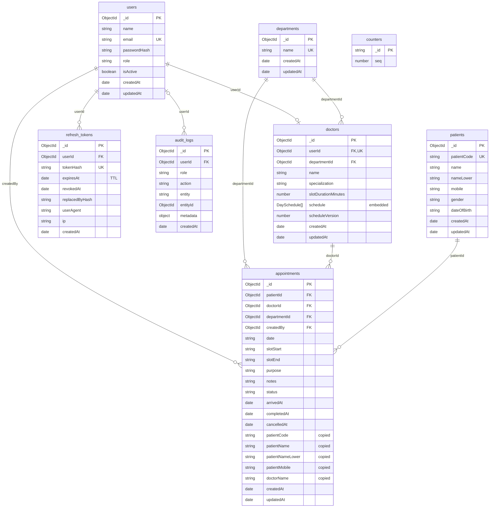
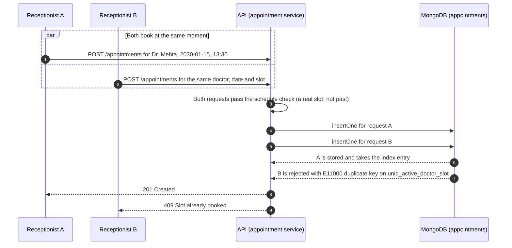
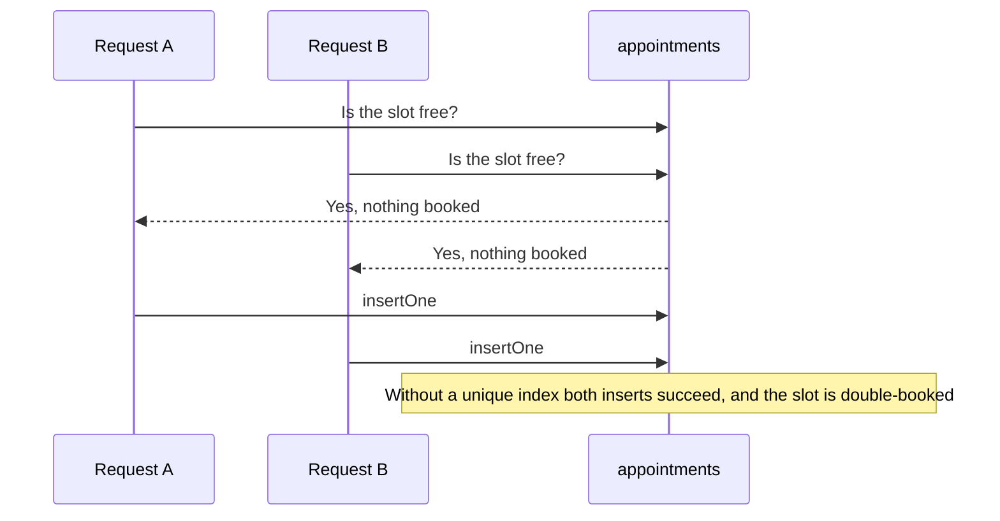
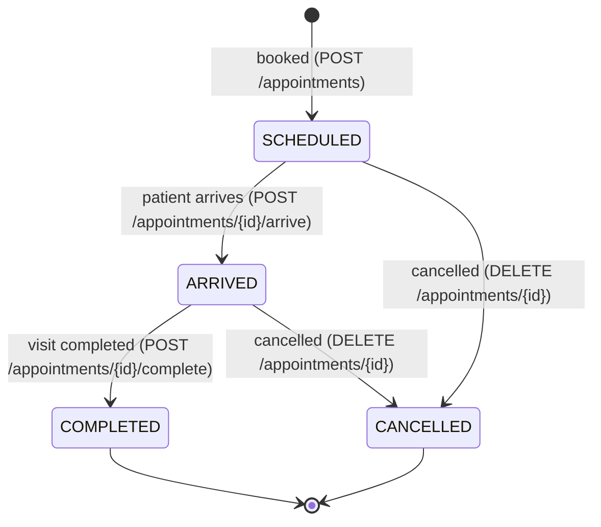
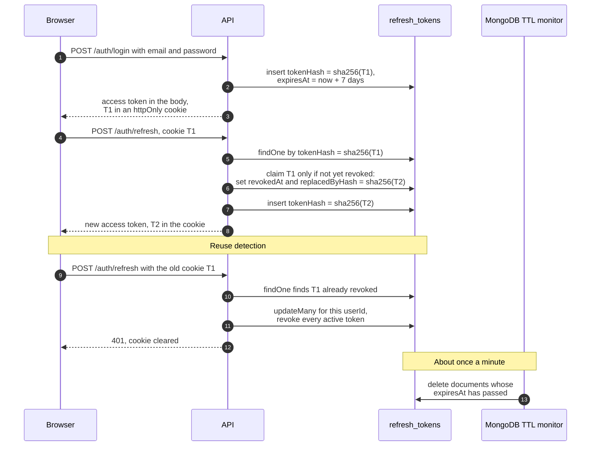
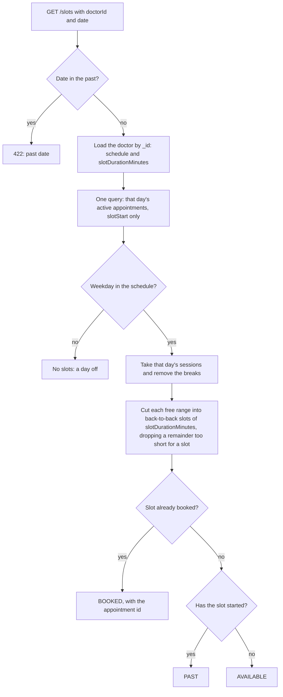

# Database design

How the EMR appointment module stores its data in MongoDB, and why. Everything here is taken from the Mongoose models in `server/src/models` and the queries in `server/src/services`. Where this document and the code disagree, the code is right.

A visual version of this document, with the same content, is in [`database-design.html`](database-design.html). Open it in a browser.

**Contents**

1. [Overview](#1-overview)
2. [ER diagram](#2-er-diagram)
3. [Collection details](#3-collection-details)
4. [Relationships and modeling choices](#4-relationships-and-modeling-choices)
5. [Indexes](#5-indexes)
6. [Double-booking prevention](#6-double-booking-prevention)
7. [Appointment status workflow](#7-appointment-status-workflow)
8. [Auth data flow](#8-auth-data-flow)
9. [Slot generation](#9-slot-generation)
10. [Query optimization strategy](#10-query-optimization-strategy)
11. [Scaling to millions of appointments](#11-scaling-to-millions-of-appointments)
12. [Glossary](#12-glossary)

---

## 1. Overview

- **Database:** MongoDB, through Mongoose. The database name comes from the path in `MONGO_URI`; `.env.example` uses `emr_appointments`.
- **Dates and times** are stored as strings in the clinic's timezone (`CLINIC_TIMEZONE`, default `Asia/Kolkata`): dates as `"YYYY-MM-DD"` and times as `"HH:mm"`. Timestamps such as `createdAt` are real `Date` values.
- **Every document** has an `_id`, which MongoDB indexes automatically. It is an ObjectId everywhere except in `counters`, where it is the sequence name.

| Collection | Model | Purpose |
| --- | --- | --- |
| `users` | `User` | Staff accounts that can log in: Super Admins, receptionists and doctors |
| `departments` | `Department` | Clinic departments, such as Cardiology |
| `doctors` | `Doctor` | A doctor's profile: department, specialization, slot length and weekly schedule |
| `patients` | `Patient` | Registered patients, each with a readable code such as `PAT-000042` |
| `appointments` | `Appointment` | Booked visits: who, with which doctor, which date and slot, and the status |
| `counters` | `Counter` | Named sequences that are incremented atomically; used for patient codes |
| `audit_logs` | `AuditLog` | An append-only record of who did what, and when |
| `refresh_tokens` | `RefreshToken` | Hashes of the refresh tokens that keep users signed in |

Appointment **slots are not a collection**. They are computed on request from the doctor's schedule ([section 9](#9-slot-generation)).

## 2. ER diagram

Each box is a collection with its fields and their types. `PK` marks the primary key, `FK` a reference to another collection, and `UK` a unique field. Each line is a reference between documents, labelled with the field that holds it. The line ends show cardinality:

| Line end | Meaning |
| --- | --- |
| `\|\|` | exactly one |
| `o\|` | zero or one |
| `o{` | zero or many |



Allowed values, limits and notes for every field are in [section 3](#3-collection-details).

## 3. Collection details

Mongoose also adds a version key, `__v`, to every collection except `counters`. It is left out of the tables below. "Auto" means that Mongoose or MongoDB fills the field in.

### users

| Field | Type | Required | Notes |
| --- | --- | --- | --- |
| `_id` | ObjectId | auto | |
| `name` | String | yes | Trimmed, at most 100 characters |
| `email` | String | yes | **Unique.** Stored lowercase and trimmed, at most 254 characters |
| `passwordHash` | String | yes | bcrypt hash. `select: false`, so queries leave it out unless asked; only the login check asks. `toJSON` removes it too. |
| `role` | String | yes | `SUPER_ADMIN`, `RECEPTIONIST` or `DOCTOR` |
| `isActive` | Boolean | yes | Default `true`. An inactive user can't log in or refresh. |
| `createdAt`, `updatedAt` | Date | auto | Timestamps |

```js
{
  _id: ObjectId('6abde1c8c1d2e3f4a50b1d10'),
  name: 'Dr. Kavya Mehta',
  email: 'kavya.mehta@clinic.example',
  passwordHash: '$2b$12$C6UzMDM.H6dfI/f/IKcEeO5vXc7d1nZ5w0F2Jk9qT3eL8yYx1aB2C',
  role: 'DOCTOR',
  isActive: true,
  createdAt: ISODate('2026-10-01T04:30:00.000Z'),
  updatedAt: ISODate('2026-10-01T04:30:00.000Z'),
  __v: 0
}
```

### departments

| Field | Type | Required | Notes |
| --- | --- | --- | --- |
| `_id` | ObjectId | auto | |
| `name` | String | yes | **Unique, ignoring case**: "Cardiology" and "cardiology" can't both exist. Trimmed, at most 100 characters. |
| `createdAt`, `updatedAt` | Date | auto | Timestamps |

```js
{
  _id: ObjectId('6ab9d830c1d2e3f4a50b1c01'),
  name: 'Cardiology',
  createdAt: ISODate('2026-09-28T03:00:00.000Z'),
  updatedAt: ISODate('2026-09-28T03:00:00.000Z'),
  __v: 0
}
```

### doctors

| Field | Type | Required | Notes |
| --- | --- | --- | --- |
| `_id` | ObjectId | auto | The doctor's id, used in appointments and slot queries |
| `userId` | ObjectId → `users` | yes | **Unique**: one profile per user account |
| `departmentId` | ObjectId → `departments` | yes | |
| `name` | String | yes | Copied from the user account. Trimmed, at most 100 characters. |
| `specialization` | String | yes | Trimmed, at most 100 characters |
| `slotDurationMinutes` | Number | yes | A whole number from 5 to 240 |
| `schedule` | Array of day objects | no | Default `[]`, which means no working days. **Embedded.** The whole array is checked by `findScheduleProblems` (see below). |
| `schedule[].dayOfWeek` | Number | yes | 0 = Sunday to 6 = Saturday. Each day appears at most once. |
| `schedule[].sessions` | Array of `{ start, end }` | no | Working hours as `"HH:mm"`. At least one per listed day, none overlapping. |
| `schedule[].breaks` | Array of `{ start, end }` | no | Must fall within that day's working hours, and may not overlap each other |
| `scheduleVersion` | Number | no | Default 0. Goes up by one with every schedule change, so a change can be undone only if nothing replaced it since (see below). |
| `createdAt`, `updatedAt` | Date | auto | Timestamps |

The embedded day and time-range objects have no `_id` of their own (`_id: false`). The schedule rules:

- Each listed day has at least one session.
- Every range starts before it ends.
- Sessions don't overlap, and neither do breaks. Ranges are half-open, so 09:00–12:00 and 12:00–13:00 touch without overlapping.
- A break falls between the day's first session start and its last session end. It may sit in the gap between two sessions.

```js
{
  _id: ObjectId('6abde1c8c1d2e3f4a50b1d11'),
  userId: ObjectId('6abde1c8c1d2e3f4a50b1d10'),
  departmentId: ObjectId('6ab9d830c1d2e3f4a50b1c01'),
  name: 'Dr. Kavya Mehta',
  specialization: 'Interventional Cardiology',
  slotDurationMinutes: 15,
  schedule: [
    {
      dayOfWeek: 1,
      sessions: [ { start: '09:00', end: '12:00' }, { start: '13:00', end: '17:00' } ],
      breaks: [ { start: '12:00', end: '13:00' } ]
    },
    {
      dayOfWeek: 3,
      sessions: [ { start: '10:00', end: '14:00' } ],
      breaks: []
    }
  ],
  createdAt: ISODate('2026-10-01T04:30:00.000Z'),
  updatedAt: ISODate('2026-10-05T06:12:40.000Z'),
  __v: 0
}
```

### patients

| Field | Type | Required | Notes |
| --- | --- | --- | --- |
| `_id` | ObjectId | auto | |
| `patientCode` | String | yes | **Unique.** For example `PAT-000042`, numbered by the `patientCode` counter. |
| `name` | String | yes | Trimmed, at most 100 characters |
| `nameLower` | String | yes | A lowercase copy of `name`, set automatically before every validation. Used for prefix search. |
| `mobile` | String | yes | 10 digits starting with 6–9, normalized before saving. **Not unique**, because families often share a phone. |
| `gender` | String | yes | `MALE`, `FEMALE` or `OTHER` |
| `dateOfBirth` | String | no | `"YYYY-MM-DD"`. The booking validator also rejects future dates. |
| `createdAt`, `updatedAt` | Date | auto | Timestamps |

```js
{
  _id: ObjectId('6ac8bba3c1d2e3f4a50b1e20'),
  patientCode: 'PAT-000042',
  name: 'Asha Rao',
  nameLower: 'asha rao',
  mobile: '9876543210',
  gender: 'FEMALE',
  dateOfBirth: '1990-05-14',
  createdAt: ISODate('2026-10-09T10:02:11.000Z'),
  updatedAt: ISODate('2026-10-09T10:02:11.000Z'),
  __v: 0
}
```

### appointments

| Field | Type | Required | Notes |
| --- | --- | --- | --- |
| `_id` | ObjectId | auto | |
| `patientId` | ObjectId → `patients` | yes | |
| `doctorId` | ObjectId → `doctors` | yes | |
| `departmentId` | ObjectId → `departments` | yes | Always copied from the doctor at booking. A `departmentId` sent by the client is only checked against it (422 if it differs). |
| `date` | String | yes | `"YYYY-MM-DD"` in the clinic's timezone |
| `slotStart` | String | yes | `"HH:mm"`. Must be a slot the doctor's schedule offers. |
| `slotEnd` | String | yes | `"HH:mm"`. Computed from the slot, never sent by the client. |
| `purpose` | String | yes | Trimmed, at most 200 characters |
| `notes` | String | no | Consultation notes. Default `""`, at most 2000 characters. |
| `status` | String | yes | `SCHEDULED`, `ARRIVED`, `COMPLETED` or `CANCELLED`. Default `SCHEDULED`. |
| `createdBy` | ObjectId → `users` | yes | The staff member who booked it |
| `arrivedAt`, `completedAt`, `cancelledAt` | Date | no | Set by the matching status change |
| `patientCode`, `patientName`, `patientMobile` | String | yes | **Copied** from the patient at booking time |
| `patientNameLower` | String | yes | Lowercase copy of `patientName`, set automatically |
| `doctorName` | String | yes | **Copied** from the doctor at booking time |
| `createdAt`, `updatedAt` | Date | auto | Timestamps |

```js
{
  _id: ObjectId('6ac8bba3c1d2e3f4a50b1e21'),
  patientId: ObjectId('6ac8bba3c1d2e3f4a50b1e20'),
  doctorId: ObjectId('6abde1c8c1d2e3f4a50b1d11'),
  departmentId: ObjectId('6ab9d830c1d2e3f4a50b1c01'),
  date: '2026-10-12',
  slotStart: '09:15',
  slotEnd: '09:30',
  purpose: 'Follow-up after ECG',
  notes: 'BP 130/85. Review in two weeks.',
  status: 'COMPLETED',
  createdBy: ObjectId('6ab9d95cc1d2e3f4a50b1c09'),
  arrivedAt: ISODate('2026-10-12T03:41:05.000Z'),
  completedAt: ISODate('2026-10-12T04:02:47.000Z'),
  patientCode: 'PAT-000042',
  patientName: 'Asha Rao',
  patientNameLower: 'asha rao',
  patientMobile: '9876543210',
  doctorName: 'Dr. Kavya Mehta',
  createdAt: ISODate('2026-10-09T10:02:11.000Z'),
  updatedAt: ISODate('2026-10-12T04:02:47.000Z'),
  __v: 0
}
```

This is Asha Rao's 09:15 visit on Monday 12 October 2026, booked on 9 October. Stored times are UTC, so `arrivedAt` is 09:11 and `completedAt` is 09:32 in Asia/Kolkata. Monday is day 1 in Dr. Mehta's schedule above, and 09:15–09:30 is one of its 15-minute slots.

### counters

| Field | Type | Required | Notes |
| --- | --- | --- | --- |
| `_id` | String | yes | The sequence name. Today there is one: `patientCode`. |
| `seq` | Number | yes | The last number handed out. Default `0`. |

The schema turns off the version key, so there is no `__v`.

```js
{ _id: 'patientCode', seq: 42 }
```

### audit_logs

| Field | Type | Required | Notes |
| --- | --- | --- | --- |
| `_id` | ObjectId | auto | |
| `userId` | ObjectId → `users` | no | Who acted. Missing for a failed login with an unknown email. |
| `role` | String | no | The actor's role, when known |
| `action` | String | yes | `LOGIN`, `LOGIN_FAILED`, `LOGOUT`, `REFRESH_TOKEN_REUSE`, `CREATE`, `UPDATE`, `CANCEL`, `ARRIVE` or `COMPLETE` |
| `entity` | String | yes | `USER`, `DOCTOR`, `PATIENT` or `APPOINTMENT` |
| `entityId` | ObjectId | no | The record that was acted on |
| `metadata` | Object | no | Extra context, such as the attempted email, the reason, the IP and user agent, or the changed field names. Never secrets or clinical text. |
| `createdAt` | Date | auto | There is no `updatedAt`, because entries are never edited |

```js
{
  _id: ObjectId('6ac8bba3c1d2e3f4a50b1e23'),
  userId: ObjectId('6ab9d95cc1d2e3f4a50b1c09'),
  role: 'RECEPTIONIST',
  action: 'CREATE',
  entity: 'APPOINTMENT',
  entityId: ObjectId('6ac8bba3c1d2e3f4a50b1e21'),
  metadata: { doctorId: '6abde1c8c1d2e3f4a50b1d11', date: '2026-10-12', slotStart: '09:15' },
  createdAt: ISODate('2026-10-09T10:02:11.000Z'),
  __v: 0
}
```

### refresh_tokens

| Field | Type | Required | Notes |
| --- | --- | --- | --- |
| `_id` | ObjectId | auto | |
| `userId` | ObjectId → `users` | yes | |
| `tokenHash` | String | yes | **Unique.** The SHA-256 hash of the refresh token, never the token itself. |
| `expiresAt` | Date | yes | **TTL**: MongoDB deletes the document after this time |
| `revokedAt` | Date | no | Set at logout, at rotation, when all of a user's sessions are revoked, or when a deactivated user tries to refresh |
| `replacedByHash` | String | no | Set at rotation: the hash of the token that replaced this one |
| `userAgent` | String | no | At most 500 characters |
| `ip` | String | no | At most 100 characters |
| `createdAt` | Date | auto | There is no `updatedAt` |

```js
{
  _id: ObjectId('6ad347a3c1d2e3f4a50b1f40'),
  userId: ObjectId('6ab9d95cc1d2e3f4a50b1c09'),
  tokenHash: '05437a6b2f3518d8e500cb45e9c7b48964ff845a798c3e164ecd31ed5251aa4c',
  expiresAt: ISODate('2026-10-24T10:02:11.000Z'),
  revokedAt: ISODate('2026-10-17T10:17:30.000Z'),
  replacedByHash: '9b1f6c0e2d7a4c58e3b2f1a0d9c8b7a6f5e4d3c2b1a09f8e7d6c5b4a39281706',
  userAgent: 'Mozilla/5.0 (Windows NT 10.0; Win64; x64)',
  ip: '10.0.0.24',
  createdAt: ISODate('2026-10-17T10:02:11.000Z'),
  __v: 0
}
```

## 4. Relationships and modeling choices

MongoDB lets you either **reference** another document (store its `_id`) or **embed** data inside a document. This design embeds only the doctor's schedule. Everything else is referenced, and appointments also keep copies of a few fields they display.

| Relationship | How | Why |
| --- | --- | --- |
| User 1–1 Doctor | Referenced: `doctors.userId`, made unique | A login account and a clinical profile are different things. Auth reads users; scheduling reads doctors. The unique index enforces one profile per account. |
| Department 1–N Doctor | Referenced: `doctors.departmentId` | Many doctors share one department. A page of doctors gets all its department names in one `$in` query. |
| Doctor's weekly schedule | **Embedded** in the doctor | See below |
| Patient 1–N Appointment | Referenced: `appointments.patientId`, plus copied fields | A patient can have any number of appointments, so they can't be embedded in the patient |
| Doctor 1–N Appointment | Referenced: `appointments.doctorId`, plus `doctorName` | Same reason, unbounded |
| Department 1–N Appointment | Referenced: `appointments.departmentId`, taken from the doctor | Department filters on the appointment list need no lookup |
| User 1–N Appointment | Referenced: `appointments.createdBy` | Records who booked it |
| User 1–N RefreshToken | Referenced: `refresh_tokens.userId` | Each signed-in session has one active token at a time, and every rotation adds a new one. Tokens expire on their own (TTL), and all of a user's tokens can be revoked in one update. |
| User 1–N AuditLog | Referenced and optional: `audit_logs.userId` | Append-only and growing; a failed login with an unknown email has no user |

### Why the schedule is embedded in the doctor

- It is always read together with the doctor: slot generation and booking need both.
- It is small and bounded: at most 7 days, each with a few sessions and breaks.
- It is replaced as a whole (`PUT /doctors/:id/schedule`), never edited one entry at a time.
- It is validated as a whole: the rules compare a day's sessions with its breaks.
- **It can't strand a booking.** A change is refused if a SCHEDULED or ARRIVED appointment dated today or later would lose its slot: no slot of the new grid with the same date, start and end. The check is one query on `{ doctorId, date }`, then slot generation per date. A booking saved in the same moment is caught by a second check after the change is saved. If a booking it missed would be stranded, the change is undone with a compare-and-set on `scheduleVersion`, so a later change is never overwritten. The booking itself re-checks its slot after saving.

### Why appointments copy patientName, patientMobile and doctorName

The appointment list is the busiest screen. It searches by patient name and mobile, filters and sorts, and shows names. With copies on the appointment, one query answers all of that from indexes. Without them, every list request would need a `$lookup` (a join) into `patients` and `doctors` before it could filter or sort.

- `patientCode` is copied too, for display.
- `patientNameLower` is a lowercase copy kept up to date by a small schema plugin, so case-insensitive prefix search can use an index.
- **The trade-off:** if a patient's name or a doctor's name changed later, old appointments would keep the old value. This module has no flows that edit those fields. If it gets them, a background job can update the copies.

### Why slots are generated on the fly, not stored

A slot is *derived* data: it follows from the doctor's schedule, the slot length and the date.

- **Stored slots would go stale.** Every schedule change would mean regenerating future slots and keeping them in sync with bookings, and every cancellation would have to "free" a stored slot.
- **Computed slots stay correct.** They are always right for the current schedule, and a cancelled appointment frees its slot automatically, because the unique index ignores cancelled appointments.
- **It's cheap.** Computing them costs two indexed queries per request (the doctor and that day's appointments) plus a pure function that is fully unit-tested.

## 5. Indexes

An index lets MongoDB find documents without reading the whole collection. Every collection also has the automatic unique index on `_id`. These indexes were read back from a running database (MongoDB 8.2.6), not just copied from the code:

| Collection | Index (name) | Type | Query it serves | Why it is needed |
| --- | --- | --- | --- | --- |
| `users` | `{ email: 1 }` (`email_1`) | unique | Login: `findOne({ email })` | Fast login lookup, and one account per email (emails are stored lowercase) |
| `departments` | `{ name: 1 }` (`name_1`) | unique, case-insensitive collation (`en`, strength 2) | List all departments, sorted by name with the same collation; the seed script's upsert by name | Prevents "Cardiology" and "cardiology" from both existing |
| `doctors` | `{ userId: 1 }` (`userId_1`) | unique | At login and refresh: `findOne({ userId })`, to put the doctor's id in the token | One profile per user |
| `doctors` | `{ departmentId: 1, name: 1 }` (`departmentId_1_name_1`) | compound | Doctor list: `find({ departmentId })` sorted by `{ name: 1 }` | Filter by department and sort by name from one index |
| `doctors` | `{ name: 1 }` (`name_1`), `{ specialization: 1 }` (`specialization_1`) | single field | The doctor list sorted by name; doctor search ("contains" on name or specialization); the appointment list's `doctorName` filter | A scan of a small index instead of the collection |
| `patients` | `{ patientCode: 1 }` (`patientCode_1`) | unique | Search by code: `find({ patientCode: 'PAT-000042' })` | Codes are unique, and staff look patients up by them |
| `patients` | `{ mobile: 1 }` (`mobile_1`) | single field | Search by mobile: `find({ mobile: /^98765/ })` | Anchored prefix match while typing |
| `patients` | `{ nameLower: 1, _id: 1 }` (`nameLower_1__id_1`) | compound | The patient list sorted by name, with `_id` as the tie-breaker | Rows come from the index in order; no in-memory sort |
| `appointments` | `{ doctorId: 1, date: 1, slotStart: 1 }` (`uniq_active_doctor_slot`) | **partial unique**, compound | Every booking insert; also the slot grid query `find({ doctorId, date, status: { $in: [active statuses] } })` | **Prevents double booking**. See below. |
| `appointments` | `{ doctorId: 1, date: 1 }` (`doctorId_1_date_1`) | compound | A doctor's own list, `{ doctorId }` with an optional date range; the `doctorName` filter after it becomes `{ doctorId: { $in: [...] } }` | The partial index above can't serve queries that don't filter on status |
| `appointments` | `{ status: 1, date: 1 }` (`status_1_date_1`) | compound | List filtered by `status`, with a date range | "Today's SCHEDULED appointments" |
| `appointments` | `{ departmentId: 1, date: 1 }` (`departmentId_1_date_1`) | compound | List filtered by `departmentId`, with a date range | Department view |
| `appointments` | `{ date: 1, slotStart: 1, _id: 1 }` (`date_1_slotStart_1__id_1`) | compound | The default list (sorted by date and time) and lists filtered by a date range | The list in order straight from the index, forwards or backwards |
| `appointments` | `{ patientMobile: 1 }` (`patientMobile_1`) | single field | List filter `{ patientMobile: /^98765/ }` | Mobile search on the copied field |
| `appointments` | `{ patientNameLower: 1, _id: 1 }` (`patientNameLower_1__id_1`) | compound | The list sorted by patient name | Sort without reading the whole collection |
| `appointments` | `{ createdAt: 1, _id: 1 }`, `{ doctorName: 1, _id: 1 }`, `{ status: 1, _id: 1 }` | compound | The list sorted by booking time, doctor or status | Every sort the list offers is an index (see [section 10](#10-query-optimization-strategy)) |
| `audit_logs` | `{ createdAt: -1 }` (`createdAt_-1`) | single field, descending | No query reads audit logs yet; only writes | Prepared for an audit screen: newest activity first |
| `audit_logs` | `{ entity: 1, entityId: 1, createdAt: -1 }` (`entity_1_entityId_1_createdAt_-1`) | compound | No query reads audit logs yet | Prepared for "the history of one record" |
| `refresh_tokens` | `{ tokenHash: 1 }` (`tokenHash_1`) | unique | Refresh: `findOne({ tokenHash })`; logout: `findOneAndUpdate({ tokenHash, revokedAt: { $exists: false } })` | Every refresh and logout looks a token up by its hash |
| `refresh_tokens` | `{ userId: 1 }` (`userId_1`) | single field | Reuse detection: `updateMany({ userId, revokedAt: { $exists: false } })` | Revoking all of a user's sessions at once |
| `refresh_tokens` | `{ expiresAt: 1 }` (`expiresAt_1`), `expireAfterSeconds: 0` | **TTL** | The TTL monitor, about once a minute | Deletes each token once it has expired |
| `counters` | `_id` only | automatic | `findOneAndUpdate({ _id: 'patientCode' }, { $inc: { seq: 1 } }, { upsert: true })` | Atomic sequence numbers |

There is **no text index**. A text index matches whole words and their stems, not prefixes, so it can't answer "names starting with *ash*" while someone types. A lowercase copy with an anchored regex (`/^ash/`) on an ordinary index can.

### The partial unique index on `{ doctorId, date, slotStart }`

```js
appointmentSchema.index(
  { doctorId: 1, date: 1, slotStart: 1 },
  {
    name: 'uniq_active_doctor_slot',
    unique: true,
    partialFilterExpression: { status: { $in: ['SCHEDULED', 'ARRIVED', 'COMPLETED'] } },
  },
);
```

- **Unique** means that no two documents in the index may have the same `doctorId`, `date` and `slotStart`.
- **Partial** means that only documents matching the filter are in the index at all. Appointments with status `SCHEDULED`, `ARRIVED` or `COMPLETED` hold their slot. A `CANCELLED` appointment drops out of the index, so its slot can be booked again, and any number of cancelled appointments can share one slot.
- `COMPLETED` stays in the filter, so a slot that was used can't be booked a second time.
- When an insert would break the rule, MongoDB rejects it with error **E11000 (duplicate key)**, and the API answers **409 "Slot already booked"**.
- The query planner also uses this index for the slot grid, because that query asks for exactly the statuses in the filter (measured in [section 10](#10-query-optimization-strategy)).
- At startup the server waits for every index build to finish before it starts listening, so no booking can arrive before this index exists. A failed build is logged as an error.

## 6. Double-booking prevention

Two receptionists press "Book" for the same slot at the same moment. The service inserts directly, and the unique index decides which insert wins:



**Why check-then-insert is unsafe.** The obvious approach is "look for an appointment in that slot, and insert if there is none". Two requests can both look before either one inserts:



The gap between "check" and "insert" is short, but on a busy clinic morning it is enough. A unique index closes it. MongoDB checks and writes the index entry as one atomic step, so exactly one insert can take that entry, however many arrive at once.

- **Tested through the API:** of 10 bookings sent in parallel for one slot, exactly 1 gets 201 and 9 get 409. After that appointment is cancelled, 9 parallel rebookings of the slot again give exactly one 201.
- **A new patient's booking** creates the patient record and the appointment in one **transaction**. When the slot is taken, the transaction rolls back and no orphan patient is left. Of 5 racing new-patient bookings, exactly one patient record is created (tested).

## 7. Appointment status workflow



- **The only moves allowed** are the arrows above (`STATUS_TRANSITIONS`). COMPLETED and CANCELLED are final.
- **Every move is one atomic update** whose filter contains the statuses it may start from, for example `findOneAndUpdate({ _id, status: { $in: ['SCHEDULED'] } }, { $set: { status: 'ARRIVED', arrivedAt: now } })`. If the appointment had already changed, nothing matches and the API answers 409. Of two people acting at once, only one succeeds (tested with two simultaneous cancellations).
- **Each move sets its timestamp** (`arrivedAt`, `completedAt` or `cancelledAt`) and writes an audit entry.
- **Cancelling is soft**: the document stays, and the partial unique index releases the slot.

## 8. Auth data flow

Refresh tokens are stored only as SHA-256 hashes. A leaked database therefore contains no usable token.



1. **Login** stores the hash of a new refresh token. The token itself goes to the browser in an httpOnly cookie that JavaScript can't read.
2. **Refresh** checks the token's JWT signature, looks the token up by its hash, and claims it with a conditional update, so two simultaneous refreshes can't both win. It then stores the replacement's hash. This is **rotation**: every refresh token works once.
3. **Reuse detection.** Presenting a token that was already revoked means it was copied. The service revokes **every** session of that user, using the `userId` index, and writes a `REFRESH_TOKEN_REUSE` audit entry.
4. **TTL cleanup.** Expired tokens are deleted by MongoDB itself, through the TTL index on `expiresAt`. Until then, revoked tokens stay on record, which is what makes reuse detection possible.

## 9. Slot generation



**Example.** Sessions 09:00–12:00 and 13:00–17:00, a break 12:00–13:00, and 15-minute slots give 12 morning slots (09:00 to 11:45) and 16 afternoon slots (13:00 to 16:45). That is 28 slots, none during lunch.

- If a break doesn't line up with the slot grid, slots restart at the end of the break.
- "Today" and "now" come from the clinic's timezone (luxon), whatever timezone the server runs in.
- **BOOKED wins over PAST.** A booked slot that has started still shows its appointment id, so a late arrival can be marked.
- **Booking uses the same generator.** The requested start time must be one of these slots, and must not have started.

## 10. Query optimization strategy

**How these numbers were measured.** Every list and search shape was built the way the services build it, and run with `explain("executionStats")` against the manual-QA database on Atlas (MongoDB 8). At that point it held 155 appointments, 43 patients, 4 doctors and 5 departments. A first measurement, before the sort indexes, used a local MongoDB 8.2.6 with 43,260 generated appointments; its results are kept below to show the change. The script is `qa/explain-all.mjs` in the manual QA tooling, and the server test `query-plans.test.ts` checks the shape of each unfiltered plan on every run.

**How to read the table.**

| Term | Meaning |
| --- | --- |
| **IXSCAN** | MongoDB used an index |
| **COLLSCAN** | MongoDB read every document in the collection |
| **SORT** | Sorted in memory after fetching |
| **LIMIT ← FETCH ← IXSCAN** | Rows read from the index already in order, and the scan stops after the page |
| **Keys / docs examined vs returned** | How much work was done for how many results. Ideally they're close. |

Every list page returns 20 rows.

| Shape | Index | Winning plan | Keys | Docs | Returned | Page total |
| --- | --- | --- | ---: | ---: | ---: | --- |
| appointments: list, no filter, sort date asc | `date_1_slotStart_1__id_1` | LIMIT ← FETCH ← IXSCAN | 20 | 20 | 20 | estimatedDocumentCount (metadata) |
| appointments: list, no filter, sort date desc | `date_1_slotStart_1__id_1` | LIMIT ← FETCH ← IXSCAN | 20 | 20 | 20 | estimatedDocumentCount (metadata) |
| appointments: list, no filter, sort createdAt asc | `createdAt_1__id_1` | LIMIT ← FETCH ← IXSCAN | 20 | 20 | 20 | estimatedDocumentCount (metadata) |
| appointments: list, no filter, sort createdAt desc | `createdAt_1__id_1` | LIMIT ← FETCH ← IXSCAN | 20 | 20 | 20 | estimatedDocumentCount (metadata) |
| appointments: list, no filter, sort patientName asc | `patientNameLower_1__id_1` | LIMIT ← FETCH ← IXSCAN | 20 | 20 | 20 | estimatedDocumentCount (metadata) |
| appointments: list, no filter, sort patientName desc | `patientNameLower_1__id_1` | LIMIT ← FETCH ← IXSCAN | 20 | 20 | 20 | estimatedDocumentCount (metadata) |
| appointments: list, no filter, sort doctorName asc | `doctorName_1__id_1` | LIMIT ← FETCH ← IXSCAN | 20 | 20 | 20 | estimatedDocumentCount (metadata) |
| appointments: list, no filter, sort doctorName desc | `doctorName_1__id_1` | LIMIT ← FETCH ← IXSCAN | 20 | 20 | 20 | estimatedDocumentCount (metadata) |
| appointments: list, no filter, sort status asc | `status_1__id_1` | LIMIT ← FETCH ← IXSCAN | 20 | 20 | 20 | estimatedDocumentCount (metadata) |
| appointments: list, no filter, sort status desc | `status_1__id_1` | LIMIT ← FETCH ← IXSCAN | 20 | 20 | 20 | estimatedDocumentCount (metadata) |
| appointments: list: status + date range | `date_1_slotStart_1__id_1` | LIMIT ← FETCH ← IXSCAN | 23 | 23 | 20 | COUNT_SCAN |
| appointments: list: department | `date_1_slotStart_1__id_1` | LIMIT ← FETCH ← IXSCAN | 43 | 43 | 20 | COUNT_SCAN |
| appointments: list: date range only | `date_1_slotStart_1__id_1` | LIMIT ← FETCH ← IXSCAN | 20 | 20 | 20 | COUNT_SCAN |
| appointments: list: single day | `date_1_slotStart_1__id_1` | LIMIT ← FETCH ← IXSCAN | 17 | 17 | 17 | COUNT_SCAN |
| appointments: list: patient name "asha" | `patientNameLower_1__id_1` | SORT ← FETCH ← IXSCAN | 23 | 22 | 20 | IXSCAN |
| appointments: list: patient name "rao asha" | `patientNameLower_1__id_1` | SORT ← FETCH ← IXSCAN | 1 | 0 | 0 | IXSCAN |
| appointments: list: mobile prefix | `patientMobile_1` | SORT ← FETCH ← IXSCAN | 34 | 33 | 20 | IXSCAN |
| appointments: list: doctorId (also a doctor's own list) | `date_1_slotStart_1__id_1` | LIMIT ← FETCH ← IXSCAN | 43 | 43 | 20 | COUNT_SCAN |
| appointments: list: doctorName -> doctorId $in | `date_1_slotStart_1__id_1` | LIMIT ← FETCH ← IXSCAN | 43 | 43 | 20 | COUNT_SCAN |
| appointments: list: department + status + date range | `date_1_slotStart_1__id_1` | LIMIT ← FETCH ← IXSCAN | 46 | 46 | 20 | IXSCAN |
| appointments: list: status, sorted by patient name | `status_1_date_1` | SORT ← FETCH ← IXSCAN | 24 | 24 | 20 | COUNT_SCAN |
| appointments: slot grid: a doctor's day | `doctorId_1_date_1` | LIMIT ← FETCH ← IXSCAN | 12 | 12 | 12 | COUNT_SCAN |
| appointments: schedule guard: appointments still to happen | `date_1_slotStart_1__id_1` | LIMIT ← FETCH ← IXSCAN | 45 | 45 | 20 | IXSCAN |
| patients: search: patient code | `patientCode_1` | SORT ← FETCH ← IXSCAN | 1 | 1 | 1 | EXPRESS_IXSCAN |
| patients: search: mobile prefix | `mobile_1` | SORT ← FETCH ← IXSCAN | 4 | 3 | 3 | IXSCAN |
| patients: search: name "asha" | `nameLower_1__id_1` | LIMIT ← FETCH ← IXSCAN | 2 | 1 | 1 | IXSCAN |
| patients: search: name "rao" | `nameLower_1__id_1` | LIMIT ← FETCH ← IXSCAN | 1 | 0 | 0 | IXSCAN |
| patients: search: name "rao asha" | `nameLower_1__id_1` | LIMIT ← FETCH ← IXSCAN | 1 | 0 | 0 | IXSCAN |
| patients: search: mobile duplicates (exact number) | `mobile_1` | SORT ← FETCH ← IXSCAN | 3 | 2 | 2 | IXSCAN |
| patients: list: no search term | `nameLower_1__id_1` | LIMIT ← FETCH ← IXSCAN | 20 | 20 | 20 | estimatedDocumentCount (metadata) |
| doctors: list: no filter, sorted by name | `name_1` | LIMIT ← FETCH ← IXSCAN | 4 | 4 | 4 | estimatedDocumentCount (metadata) |
| doctors: list: department, sorted by name | `departmentId_1_name_1` | LIMIT ← FETCH ← IXSCAN | 1 | 1 | 1 | COUNT_SCAN |
| doctors: list: search "iyer" (name or specialization contains) | `name_1` | SUBPLAN ← LIMIT ← FETCH ← IXSCAN | 4 | 4 | 1 | IXSCAN |
| doctors: doctorName filter lookup | `name_1` | LIMIT ← FETCH ← IXSCAN | 4 | 1 | 1 | IXSCAN |
| departments: list, sorted by name (not paginated, no count) | `name_1` | LIMIT ← FETCH ← IXSCAN | 5 | 5 | 5 | none |
| users: login: user by email | `email_1` | EXPRESS_IXSCAN | 1 | 1 | 1 | EXPRESS_IXSCAN |
| refresh_tokens: refresh: token by hash | `tokenHash_1` | EXPRESS_IXSCAN | 0 | 0 | 0 | EXPRESS_IXSCAN |

**No query reads a whole collection.** Each of the 37 shapes uses an index, and so does each page total: the unfiltered lists take theirs from the collection's metadata (`estimatedDocumentCount`), and every filtered total is a COUNT_SCAN or an IXSCAN.

### Every list sort is an index

Each sort the list offers ends with `_id`, the tie-breaker that keeps pages stable, and each has an index with exactly those fields: `{ date, slotStart, _id }`, `{ patientNameLower, _id }`, `{ createdAt, _id }`, `{ doctorName, _id }` and `{ status, _id }`. Read forwards or backwards, the index returns rows already in order, so an unfiltered list examines 20 index keys and 20 documents for a page of 20, whatever the size of the collection. The same holds for the patient list (`{ nameLower, _id }`) and the doctor list (`{ name }`).

Before this change, measured on the 43,260-appointment dataset:

| Query | Before | After |
| --- | --- | --- |
| Appointment list, default | SORT ← COLLSCAN, 43,260 docs, 160 ms | IXSCAN on `{ date, slotStart, _id }`, **20** docs, 1 ms |
| Appointment list, sorted by patient name | SORT ← COLLSCAN, 43,260 docs, 168 ms | IXSCAN on `{ patientNameLower, _id }`, **20** docs, 1 ms |
| Patient list, no search term | SORT ← COLLSCAN, 5,000 docs, 22 ms | IXSCAN on `{ nameLower, _id }`, **20** docs, 0 ms |
| Unfiltered page totals | `countDocuments({})`: COLLSCAN of every document | `estimatedDocumentCount()`: collection metadata |

The longer indexes replace `date_1_slotStart_1`, `patientNameLower_1` and `nameLower_1`, and serve their queries too. Startup creates new indexes but never drops old ones, so an existing database is brought in line once with `npm run indexes:sync`, which runs Mongoose's `syncIndexes` on every model.

### Where a filtered list still sorts in memory

A filter that a selective index answers (a patient name or mobile prefix, a patient code) picks out a small set, which is then sorted in memory (the SORT rows above). A prefix match is a range on its index, so the same index can't also return the rows in date order. The alternative, walking the date index and filtering as it goes, would read the whole list for a rare name. The planner chooses between the two on every query, and for the date filters, departments and doctors it picks the sort index. The in-memory sort is bounded by what the filter matches; at much larger volumes, the search fields (name words and mobile) are the ones to move to Atlas Search.

- **Equality and date filters** (`status`, `departmentId`, `doctorId`, `dateFrom` and `dateTo`) are answered by the compound indexes that start with them. The planner may also walk the `{ date, slotStart, _id }` index and filter as it goes when that reads less.
- **The slot grid is the cheapest query:** a doctor's day on `{ doctorId, date }`, 12 keys for 12 appointments.
- **The schedule-change check** (appointments still to happen, see [Why the schedule is embedded](#why-the-schedule-is-embedded-in-the-doctor)) is one indexed query per change.
- **Every list uses `.lean()`** and `Promise.all` to run the page query and the count together. The appointment list leaves out `patientNameLower` and `__v` with a projection.

## 11. Scaling to millions of appointments

**Size today, measured.** On the measured dataset, one appointment averages about **440 bytes** of BSON. The 8 indexes it had then (`_id` and 7 more) took about **94 bytes per appointment** together, from 10 bytes for `status_1_date_1` to 17 bytes for `uniq_active_doctor_slot` (WiredTiger compresses index keys). The sort indexes added after manual QA bring the count to 11. An estimate, not a measurement: each new index costs about the same as the existing ones, so about **140 bytes per appointment** in all, roughly half as much again as the figures below:

| Appointments | Documents (before compression) | Indexes |
| ---: | ---: | ---: |
| 1 million | ~440 MB | ~94 MB |
| 10 million | ~4.4 GB | ~0.9 GB |
| 100 million | ~44 GB | ~9.4 GB |

Real data, with longer names and notes, will be larger. Indexes need to fit in memory (the WiredTiger cache) to stay fast, so index size is the first thing to watch.

**Sharding key options** (splitting `appointments` across servers). On a sharded collection, every unique index must start with the shard key, which rules several options out:

| Shard key | Good | Bad |
| --- | --- | --- |
| `{ doctorId: 1, date: 1 }` (ranged) | A doctor's day (slot grid, booking, the doctor's own list) goes to one shard. The double-booking index `{ doctorId, date, slotStart }` starts with the shard key, so it stays enforceable. | Admin lists across all doctors, by date or status, ask every shard. A very busy doctor's range can get hot. |
| `{ doctorId: "hashed" }` | Spreads writes evenly across shards | Loses range locality. Check carefully how the double-booking unique index can be kept under a hashed key before choosing it. |
| `{ date: 1 }` | Date-range lists touch few shards | Every new booking lands on the newest dates, which makes one hot shard. The unique index doesn't start with `date`, so double-booking protection would be lost. |
| `{ departmentId: 1, date: 1 }` | Department views stay local | Few departments means few, uneven chunks, and again the unique index doesn't start with the key |
| `{ _id: "hashed" }` | Perfectly even writes | Every list and slot query asks every shard, and the unique index can't be kept |

**Recommendation:** a ranged `{ doctorId: 1, date: 1 }`. It keeps the data-integrity guarantee and keeps the clinic's most frequent screens on one shard.

- **Archive old appointments.** A nightly job could move COMPLETED and CANCELLED appointments older than, say, 12 months to an `appointments_archive` collection or to Atlas Online Archive. The working set and its indexes stay small, while patient history can still read the archive.
- **TTL on audit logs.** Today there is deliberately no TTL, because medical audit trails usually must be kept for years. At scale:
  - Agree the retention period first.
  - Then either add a TTL index on `createdAt` with that period, or, better, export older entries to cheap storage before deleting them.
  - Audit logs could also move to their own cluster, so their write volume doesn't compete with bookings.
- **Read replicas.** Lists, searches and reports can read from secondaries (`readPreference: secondaryPreferred`) and accept data a second or so old. Bookings and status changes always go to the primary. The slot grid is safest on the primary too, so a slot booked a moment ago doesn't look free. A booking stays safe either way, because the unique index lives on the primary.
- **Index size.**
  - Keep the number of indexes on `appointments` in check: each one costs write time and memory. The recommended fix in section 10 replaces indexes rather than adding them.
  - A partial index (like the double-booking one) indexes only the documents that need it.
  - Patient-name search could move to Atlas Search, so the name indexes stop growing with every appointment.
- **The counter document.** Every new patient increments one counter document. At very high registration rates, hand out code ranges in blocks (hi/lo allocation) instead of one at a time.

## 12. Glossary

| Term | Meaning |
| --- | --- |
| **Collection** | A group of documents, like a table in SQL. `appointments` is a collection. |
| **Document** | One record, stored as BSON (binary JSON). One appointment is one document. |
| **ObjectId** | MongoDB's default 12-byte id, written as 24 hex characters, for example `6ac8bba3c1d2e3f4a50b1e21`. Its first 4 bytes are the creation time in seconds (`6ac8bba3` is 9 October 2026, 10:02:11 UTC), so ids created later sort later. |
| **Index** | An extra, sorted structure that lets MongoDB find documents without reading the whole collection, like the index at the back of a book |
| **Compound index** | An index on several fields in a set order, such as `{ doctorId, date }`. It serves queries on the first field, or on the first and second, and so on: on a prefix of its fields. |
| **Unique index** | An index that refuses a second document with the same key values. The database itself enforces the rule. |
| **Partial index** | An index that only contains documents matching a filter, such as "status is not CANCELLED". Smaller, and with a partial unique index the rule applies only to those documents. |
| **TTL index** | "Time to live": an index on a date field that makes MongoDB delete each document once that date (plus an optional delay) has passed |
| **Text index** | An index for full-text word search. Not used here, because it can't match the start of a word. |
| **IXSCAN / COLLSCAN** | In a query plan: reading an index, versus reading every document in the collection |
| **Denormalization** | Storing a copy of data in a second place (for example the patient's name on each appointment) so reads don't need a join. The cost is keeping copies in sync. |
| **Embedding vs referencing** | Embedding puts related data inside the document, like the schedule inside the doctor. Referencing stores another document's `_id` and looks it up when needed, like `appointments.patientId`. Embed what is small, bounded and always read together; reference what grows or is shared. |
| **`$lookup`** | MongoDB's join: pulling matching documents from another collection into a query's results |
| **Transaction** | A group of writes that succeed together or not at all. Used here when a new patient is booked: the patient and the appointment are saved together, or neither is. Needs a replica set. |
| **Replica set** | Several MongoDB servers holding the same data. One primary takes writes, and secondaries copy it and can serve reads. |
| **Shard key** | The field or fields MongoDB uses to split a collection across servers (shards) |
| **E11000** | MongoDB's "duplicate key" error, raised when a write would break a unique index |
| **Lean query** | A Mongoose query that returns plain JavaScript objects instead of full Mongoose documents: faster, and enough for reading |
